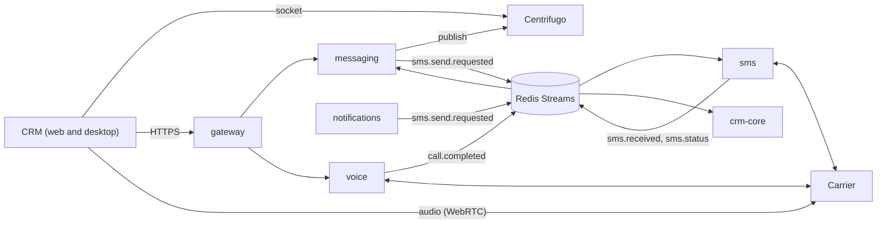

# Messaging, texting and calling: three containers, built on what already exists

**Status:** Proposed (amends `service-architecture.md`, which has one `dialer-sms` service)
**Date:** 2026-11-14

## The short version

Three containers of our own, each a thin layer over something that already exists. We write the parts that are specific to Caller Whale (who may see which conversation, leads, consent, state calling rules) and buy or reuse the hard, generic parts (live delivery to thousands of sockets, carrier connections, telephony).

| Container | We reuse | We write |
| --- | --- | --- |
| **messaging** | **Centrifugo** (open source, Go, Apache 2.0) for live delivery, presence and missed-message recovery | The conversation tables and API: threads, members, messages, reactions, polls, read state, attachments |
| **sms** | A carrier's messaging API (recommended: **Telnyx**) for sending, receiving, number rental and carrier registration | The send queue, opt-out (STOP), quiet hours and state rules, delivery status, inbound webhooks |
| **voice** | The same carrier's **browser-calling SDK and call-control API** | Calling tokens, the auto-dial queue, call webhooks, recordings, call logs |

`messaging` owns every conversation, internal and external. That is what makes one unified system possible: an SMS thread is a conversation whose messages happen to travel through `sms`.

## What exists today

- `services/features/dialer-sms/`: a TypeScript scaffold (health check only) meant to hold calling and texting together.
- `services/notifications/`: sends email; the rules say it is the only service that talks to an SMS provider.
- `services/crm-core/` (Go): has a live-updates socket (in memory, one process) and a `message.draft` operation, but stores no conversations.
- The CRM's Inbox and Mail pages already model Team, Group, Partner and SMS threads, with replies, reactions, mentions, polls, archive and unread counts, on demo data.

## What was looked at, and why it was or was not chosen

### Messaging

| Option | What it is | Verdict |
| --- | --- | --- |
| **Centrifugo + our own tables** | A ready-made real-time server. Our service publishes to it; browsers and the desktop app hold the socket to it. Scales over several copies through Redis (which we already run). | **Recommended.** The wheel worth not reinventing is live delivery; the conversation tables are small and must follow our workspace and visibility rules anyway. |
| Twilio Conversations | Hosted. One API for chat, SMS and group texting in the same thread: up to 1,000 participants, 50 of them by SMS or WhatsApp, group texts up to 10. First 200 active users a month free, then about $0.05 each, plus normal SMS charges. | **The fastest route to a unified inbox**, and the fallback if we want less to run. Not chosen first because it ties texting to Twilio's prices (about twice Telnyx's) and keeps every conversation on Twilio's servers. |
| Hosted chat APIs (Stream, Sendbird, TalkJS) | Chat as a service with ready-made screens. Priced per active user: roughly $240 to $430 a month at 10,000 users. | No. We already have the screens; they add a monthly cost per user and none of them handle SMS. |
| Tinode | Open source chat server in Go, one-to-one and groups. GPL 3.0. | Close second. It brings its own accounts and access model, which would have to be kept in step with ours, and it has no notion of an external SMS participant. |
| Matrix (Synapse, Tuwunel) | A full federated chat protocol. Synapse is AGPL since November 2023; Tuwunel (Rust) is Apache 2.0. SMS bridges exist but are beta or months old. | No. Far more protocol than an inbox inside one product needs, and a second identity system. |
| Mattermost, Rocket.Chat | Complete team-chat products. | No. They are applications with their own screens and accounts, not a backend for ours. |
| Chatwoot | Open source customer inbox (MIT core). Twilio SMS built in, private team notes inside a customer thread. | Not adopted (a whole Rails application with its own accounts), but **its model is the one to copy for mixed threads**: a team-only note is a message with its own type, in the same thread as the customer's messages. |

### Texting and calling

| Option | Verdict |
| --- | --- |
| **Telnyx** | **Recommended carrier for both.** List prices found: about $0.004 per text against Twilio's $0.008, inbound texts free, and about $0.007 a minute for outbound US calls against Twilio's $0.014. Group texting to 8 recipients, browser calling and carrier registration are all offered. |
| Twilio | The safe default with the most documentation, and the one the older plans assume. Roughly double the cost per text and per minute. |
| Running our own telephony (Asterisk, FreeSWITCH, jambonz, VICIdial) | No. These are the real wheel. Self-hosted jambonz needs a paid licence key; VICIdial and the like are whole call-centre products. We would still need a carrier underneath, and would take on audio quality, uptime and number reputation ourselves. |

Why cost decides it: the Dialer is sold as **unlimited calling** with 1,500 texts at $99 a month. A caller who talks four hours a day uses about 5,300 minutes a month: roughly $37 at Telnyx's rate, $74 at Twilio's, before number rental.

Every price above comes from vendor or comparison pages read on 2026-11-14, several of them published by Telnyx itself. **Confirm on both official pricing pages before committing.**

## How the unified system works

A conversation has participants of two kinds: a **member** of the workspace, or an **external party** (a phone number, linked to a lead when one matches). Every message says how it travels.

| Kind of conversation | Participants | Where messages go |
| --- | --- | --- |
| Team chat, group | Members only | Stay in `messaging` |
| Text with a lead | One member-side inbox, one external number | `messaging` stores it; `sms` sends and receives |
| Mixed thread | Several members and one external number | Each message is either a **team note** (members only) or **sent to the customer** |
| External group | Members and up to 8 external numbers | Group texting through the carrier, charged at picture-message rates |

Rules that follow from this:

1. **A team note can never leave by SMS.** The composer shows which of the two is being written, in a different colour, and the service refuses to send a note outward whatever the client asks. This is the costly mistake in a mixed thread.
2. **The carrier never holds the history.** `sms` keeps only what it needs to send and to prove delivery; changing carrier does not lose a conversation.
3. **Email stays where it is** (the Mail page) for now. It can become another way a message travels later without changing the model.

## How the containers talk

- Language: **Go** for all three, like `crm-core`, `auth`, `authz` and `gateway`, so token checks, tests and container builds stay the same. (The older plan said TypeScript for `dialer-sms`.)
- Each owns its own database and login. None reads another's tables.
- `notifications` stops being the service that talks to the SMS provider: it asks `sms` to send, so one container owns the numbers, the registration and the opt-out list.
- Call audio goes straight from the app to the carrier. `voice` only issues the short-lived token and reacts to the carrier's events.
- Events to add to `contracts/events.md`: `sms.send.requested`, `sms.received`, `sms.status`. `call.completed` and `message.received` are already listed.

## Order of work

| Step | Work | Done when |
| --- | --- | --- |
| 0 | Open a carrier account and **start carrier registration** for texting. It takes days to weeks and blocks step 2, so it starts first. Test the microphone and browser calling inside the desktop app's window. | Registration submitted; a test call works from the desktop app |
| 1 | `messaging` with Centrifugo: team chats and groups, replacing the Inbox's demo data | Two people in a workspace chat live, with unread counts, replies, reactions and polls, and messages missed while offline arrive on reconnect |
| 2 | `sms`: one-to-one texting with a lead, opt-out, quiet hours, delivery status | A text to a lead and its reply appear in that lead's thread; STOP blocks further sends |
| 3 | Mixed threads: team notes beside customer messages | A note is visible to the team and provably never sent |
| 4 | `voice`: browser calling, then the auto-dial queue and call log | The Calls page places a real call and records its outcome through `crm-core` |
| 5 | External groups (group texting), only if customers ask | A thread with several external numbers works |

Calling is fourth because it has the most unknowns, but its two risks (the desktop window's microphone, registration lead time) are tested in step 0.

## Decisions needed

1. **Carrier:** Telnyx (recommended) or Twilio.
2. **Build on Centrifugo, or take Twilio Conversations** and accept the price and the lock-in for a faster start.
3. **Who registers with the carriers:** each customer's business under our account (the usual model for a product like this), which means collecting their business details at sign-up for texting.
4. **Mixed threads** in the first release, or third as above.

## Not verified

- Prices and limits come from web pages, not from accounts of our own; no service was tried.
- Whether the desktop app's window (WebView2) allows the microphone and WebRTC calling. `service-architecture.md` lists this as an open risk.
- The exact carrier registration steps and fees for a product sending on behalf of many businesses.
- Tinode's and Centrifugo's licences were read from listings, not from their repositories.
- The legal rules for texting and calling by state are in `campaigns-law-by-state.md` and `state-operating-rules.xlsx`; this plan assumes `sms` and `voice` enforce them but does not restate them.

## Sources

- [Centrifugo](https://centrifugal.dev), [Centrifugo PRO](https://centrifugal.dev/pro)
- [Twilio Conversations pricing](https://www.twilio.com/en-us/messaging/pricing/conversations-api), [Twilio Conversations limits](https://static0.twilio.com/docs/conversations/conversations-limits)
- [Telnyx: Twilio and Telnyx SMS pricing](https://telnyx.com/resources/twilio-telnyx-sms-pricing), [Telnyx group messaging](https://developers.telnyx.com/docs/messaging/messages/group-messaging), [Telnyx group messaging support article](https://support.telnyx.com/en/articles/8255134-group-messaging-bulk-sending-mms)
- [Courier: Telnyx vs Twilio](https://www.courier.com/integrations/compare/telnyx-vs-twilio), [Fora Soft: Twilio alternatives for voice](https://www.forasoft.com/blog/article/twilio-alternatives-voice-ai), [DDIY: Twilio alternatives](https://ddiy.co/twilio-alternatives/)
- [Element: Synapse moves to AGPL](https://element.io/blog/element-to-adopt-agplv3/), [Tuwunel](https://github.com/matrix-construct/tuwunel), [Matrix SMS bridges](https://matrix.org/ecosystem/bridges/sms/)
- [Chatwoot](https://github.com/chatwoot/chatwoot), [eesel: Chatwoot in 2026](https://eesel.ai/blog/chatwoot)
- [Rework: Mattermost vs Rocket.Chat](https://resources.rework.com/tools/productivity/mattermost-vs-rocket-chat), [Open source chat platform evaluation](https://dev.to/amirtaherkhani/global-open-source-chat-platform-evaluation-469b)
- [jambonz self-hosting licence](https://docs.jambonz.org/self-hosting/licensing), [Dograh: open source predictive dialers](https://www.dograh.com/feeds/blog/predictive-dialer-software-open-source)
- [TalkJS vs Sendbird](https://talkjs.com/compare/talkjs-vs-sendbird/), [Stream: Sendbird alternatives](https://getstream.io/blog/sendbird-alternatives/)
