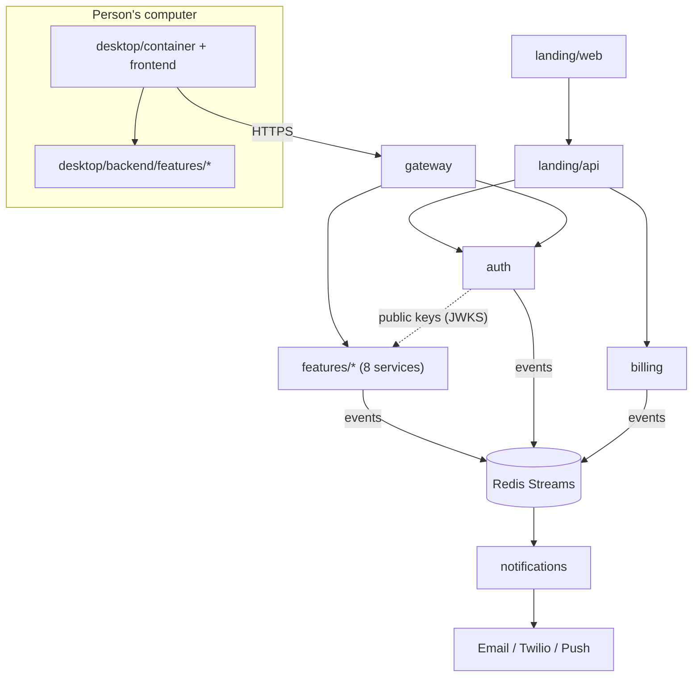

# Caller Whale CRM: services, landing site and releases

**Status:** Proposed (extends `FULL_CRM_CALLERWHALE_STRUCTURE.md`, which it amends where noted)
**Date:** 2026-10-26

## What we are building

Seven things that are built, tested and deployed on their own:

| # | Piece | Runs where | Job |
| --- | --- | --- | --- |
| 1 | **Landing site: frontend** | CDN / VPS, static | Sells the product: pricing, features, download, sign-up, sign-in link |
| 2 | **Landing site: backend** | VPS | Sign-up and checkout flow, waitlist/contact, "latest download" link, webhook receivers from the payment provider |
| 3 | **Desktop app** | The person's computer | Tauri container + React frontend |
| 4 | **Desktop backend** | The person's computer | Runs inside the app. One module per feature, works offline |
| 5 | **Authentication service** | VPS, alone | Accounts, sessions, MFA, Google sign-in, tokens, roles. Nothing else |
| 6 | **Notification service** | VPS, alone | Email, SMS, push, in-app. Nothing else |
| 7 | **Feature services** | VPS, one each | Importing lists, Skip Tracing, Dialer/SMS, Leads map, CRM, AI campaigns, Exports, Backup/restore |

Feature 9 in `docs/features` (accounts, security, billing) is not a feature service: accounts and security are piece 5, billing lives with the landing backend and a small `billing` service (see Decisions).

## Rules

1. **A service owns its data.** Own PostgreSQL database (own login, own database updates). No other service connects to it. Today only `server/rust` touches PostgreSQL; this rule generalises that.
2. **Services talk two ways only:** a synchronous call through the gateway/internal HTTP, or an event on the bus (Redis Streams to start). Never a shared table.
3. **Auth is verified, not called.** Auth signs short-lived tokens (EdDSA) and publishes its public keys at `/.well-known/jwks.json`. Every other service checks tokens locally, so auth being down does not stop a signed-in person from working.
4. **Notifications are requested by event.** A service publishes `notification.requested` (who, template, data). It never talks to Twilio, SMTP or push itself. Channels and templates live only in the notification service.
5. **Every feature has the same shape on both sides** (desktop module and server service), so adding a feature is copying a template, not designing a layout.
6. **The desktop app works offline.** The desktop backend never needs the VPS to open a list, run Skip Tracing or export. Only sign-in, sync, calling and messaging need servers.
7. **Contracts first.** Each service's HTTP API and events are in `contracts/` and checked by a contract test, as the existing API is.

## Target layout

This replaces the four-part tree in the structure document. The four parts survive as `desktop/` and `services/`; the landing site and releases are new.

```text
Caller Whale CRM/
├── desktop/                         3 + 4
│   ├── container/rust/              Tauri shell only (window, menus, permissions, updater)
│   ├── frontend/react/              Screens; talks only through src/clients/
│   └── backend/                     Rust library the container links in
│       └── features/
│           ├── importing-lists/     one module per feature, same template
│           ├── skip-tracing/        wraps the Python engine (service/)
│           ├── dialer-sms/
│           ├── leads-map/
│           ├── crm/
│           ├── ai-campaigns/
│           ├── exports/
│           └── backup-restore/
│
├── landing/                         1 + 2
│   ├── web/                         React + Vite static build, same stack as the app, no secrets
│   └── api/                         Sign-up, checkout, downloads, webhooks
│
├── services/                        5 + 6 + 7
│   ├── gateway/                     One public entry: HTTPS, token check, rate limits, routes /api/v1/<service>/*
│   ├── auth/                        Rust (reuses today's sign-in, MFA, OAuth code)
│   ├── notifications/               Go (reuses the worker's fan-out and scheduler)
│   ├── billing/                     Plans, seats, minutes, Paddle/Stripe webhooks
│   └── features/
│       ├── importing-lists/         Python  (imports, as callerwhale_worker does today)
│       ├── skip-tracing/            Python  (server-side jobs, shares service/ rules)
│       ├── dialer-sms/              TypeScript (Twilio voice, SMS, webhooks)
│       ├── leads-map/               Rust    (geocoding, nearby search)
│       ├── crm/                     Rust    (leads, tasks, sync: the core of today's API)
│       ├── ai-campaigns/           TypeScript
│       ├── exports/                 Python  (files, report PDFs)
│       └── backup-restore/          Rust
│
├── contracts/                       OpenAPI per service, events.md, local-commands.md
├── deploy/                          Docker Compose, Caddyfile, systemd, env templates
├── .github/workflows/               check.yml, release-desktop.yml, deploy-*.yml
└── docs/
```

Every `services/<x>/` has the same files: `README.md`, `Dockerfile`, `database_setup/`, `src/`, `tests/`, `openapi.yaml`, `health` endpoint on `/healthz`.



## Desktop release, triggered when you say so

Goal: you tell Claude "release 0.4.0" and it ships.

- **Workflow** `.github/workflows/release-desktop.yml`, trigger `workflow_dispatch` with inputs `version` and `notes`. It never runs on a plain push.
- **Steps:** check `desktop/` tests, set the version in `tauri.conf.json` and `Cargo.toml`, build on `windows-latest` with `tauri-action`, sign the installer, create a **draft** GitHub Release with the `.msi`/`.exe` and `latest.json`, tag `desktop-v<version>`.
- **Auto-update:** `tauri-plugin-updater` reads `latest.json` from the release, verified with an update-signing key (not the Windows code-signing certificate).
- **Landing download button:** `landing/api` asks GitHub for the latest published release, so publishing the draft is what makes it public.
- **How Claude triggers it:** `gh workflow run release-desktop.yml -f version=0.4.0`. Claude runs this only when you ask in that message, and publishes the draft only when you say so.
- **Secrets needed in the repo settings:** `TAURI_SIGNING_PRIVATE_KEY` and its password, and a Windows code-signing certificate (otherwise SmartScreen warns every user).
- **Service deploys** get their own workflows (`deploy-<service>.yml`, also manual) so a landing-page fix never ships the desktop app.

## Decisions

1. **Processes: accepted.** Each feature is its own folder, database schema and contract, but all of them run in one Docker Compose on the single VPS. Hosts are split only when load asks for it.
2. **Offline sync: accepted.** The CRM service owns sync. Other features sync their results (an export record, a call log) through the CRM.
3. **Billing: deferred.** Not built during development. The `billing` service stays a folder with its interface only; the Paddle/Stripe choice is made before launch.
4. **Landing stack: the same stack as the app** (React + Vite, plain CSS tokens shared with the app), not Astro.
5. **Code signing: deferred.** Development releases ship unsigned. The workflow keeps the signing steps behind a flag so they switch on when a certificate exists.

## Order of work

| Phase | Work | Done when |
| --- | --- | --- |
| 0 | Agree this document and amend the structure document | Status set to Accepted |
| 1 | **Landing:** `landing/web` (pricing, features, download, sign-up link) and `landing/api` (sign-up, waitlist, download link; checkout stays off until billing is chosen) on the existing API for accounts | A stranger can find the site, join the waitlist or sign up, and download the app |
| 2 | **Release pipeline** and updater | `gh workflow run` produces a draft release that installs and updates |
| 3 | **Restructure** the repo to the target layout (move, re-point configs, no behaviour change) | All existing tests pass from the new paths |
| 4 | **Auth service** split out of `server/rust`, own database, JWKS | The desktop and landing sign in through it; CRM verifies tokens locally |
| 5 | **Notification service** split out, event contract, email first, SMS next | Sign-up and invoice emails go through it |
| 6 | **Gateway** and the **feature service template**; move CRM first, then one feature at a time in the order of `docs/features` | Each feature has its own service, database, contract and tests |
| 7 | **Desktop feature modules** under `desktop/backend/features/` | Each feature runs offline from its own module |

Phases 1 and 2 come before the restructure because they are what lets you sell and ship; they only add folders. Phases 3 to 7 are the large refactor and should land one phase per pull request.

## Scaffold status (2026-10-27)

The folders and starting code from the target layout now exist beside the working app, without moving it:

- `services/`: gateway, auth, notifications, billing and the eight feature services. Each starts, answers `/healthz` and `/version`, has tests, an `openapi.yaml`, a `Dockerfile` and, when it owns data, `database_setup/`. Registry: `services/README.md`, `contracts/services.md`, event list: `contracts/events.md`.
- `desktop/`: the container, frontend and backend folders, with one Rust module per feature under `desktop/backend/features/`.
- `deploy/compose.yml`: every service plus Postgres and Redis (not run yet: no Docker on the machine that wrote it).
- `tools/`: `stack.json` (the list of services), `scaffold-stack.mjs` (creates what is missing, never overwrites) and `check-stack.mjs` (runs every test).
- Root `Cargo.toml`: one workspace for the new Rust crates; `src-tauri` and `backend/rust` stay out of it for now.

Not verified: the two Go services (gateway, notifications) were not compiled because Go was not installed, and the Dockerfiles and compose file were not run. Nothing from `backend/`, `src/` or `src-tauri/` has moved yet; that is phase 3 and later.

## Authentication: one source of truth (2026-10-27)

`services/auth` is built and runs on its own. It is the only owner of accounts, passwords, two-step codes and sessions, for every app and service. It signs 15-minute EdDSA access tokens, and every other service checks them with its public keys (`/.well-known/jwks.json`, the `callerwhale-auth-verify` crate) without calling it. All five steps in `services/auth/README.md` are done: accounts copied across, Google and Apple sign-in, email confirmation, invitations and desktop sign-in moved into auth, the website and the CRM pointed at it, and the core API's own sign-in and sessions turned off. The core API accepts only auth's tokens and refuses to start without its public keys. Its old sign-in tables are dropped once the import is confirmed in production. Organizations, memberships and roles stay with the CRM: auth says who someone is, each service decides what they may do.

## Risks

- **Splitting too early** multiplies deploys and failure modes. Mitigation: decision 1 (one Compose on one VPS).
- **Sync across services** is the hardest part. Mitigation: decision 2.
- **Unsigned installers** lose most buyers at the Windows warning. Fine in development (decision 5); required before selling.
- **Twilio and WebView2 microphone** support is untested; test it in phase 7 for the dialer before building on it (see the structure document).
