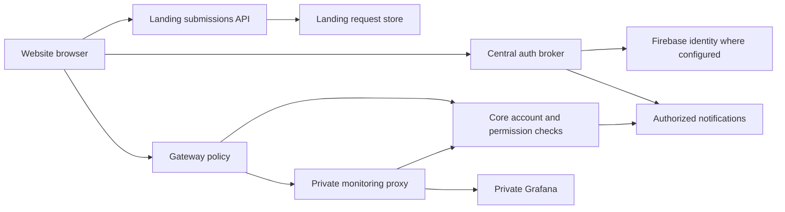

# Architecture and data contracts

Status: Proposed implementation specification, source inventory checked 2026-11-01. Not a live audit.
Parent: [Master plan](README.md).

## Frontend boundaries

Keep one public origin initially. Separate marketing, account-entry, customer-dashboard and elevated-staff layouts/route chunks. Public reading never waits for account bootstrap. A header may resolve an optional account affordance independently.

A single route registry generates routing, prerender targets, metadata, canonical/search rules and approved public navigation. Staff capabilities are a separate private authorization concern. Server output must not serialize identities or account data into reusable public HTML.

Proposed organization, not an immediate folder migration:
- app: routing, entry points, providers, error boundaries.
- layouts: marketing, auth, dashboard.
- features: public content, access request, account entry, recovery, usage, downloads, account security, staff.
- shared: tokens/components, typed transport/errors, formatting, assets.
- content: reviewed page copy, capability/status records, route metadata.
Keep provider-specific integration inside auth; do not reintroduce browser Firebase.

## Ownership map

Current service responsibilities (source model, not a live connectivity certificate):

The optional [same-origin web-session target](14-web-session-target.md) would adapt browser credential handling; it does not merge these authorities.

| Data/operation | Authority | Web responsibility |
| --- | --- | --- |
| Identity/password/provider/verification/factors/sessions | Auth; Firebase broker where configured | Present state; never infer entitlement |
| Account invitation, workspace access, monthly credits | Core API | Render exact authorized response |
| CRM workspace records and role scopes | Core API/feature services | No browser CRM extension assumed by account dashboard |
| Waitlist/contact records | Landing API/store | Validate UX; actual receipt comes from service |
| Delivery of invitation/security mail | Notifications invoked by authorized service | Show queued/sent/failed accurately; no SMTP browser access |
| Releases/assets/short-lived downloads | Release source + core authorization | Request link and download; never expose release credentials |
| Staff actions and platform audit | Core API | Require scoped elevation and reconcile results |
| Monitoring session and private Grafana | Gateway/private proxy + core role checks | Embed only during valid staff mode |
| Theme/navigation preferences | Browser preference storage | Non-sensitive only; no cross-account private cache |

## Source-backed endpoint inventory

Paths below are present in source; they are not a promise that the live service is healthy or every UI is wired. Core paths are under /api/v1; landing API has no such prefix.

| Surface | Source endpoint | Contract/use |
| --- | --- | --- |
| Bootstrap | Core GET /api/v1/auth/service | Auth address/private monitoring configuration; public safe metadata only |
| Capabilities | Auth GET /v1/providers and /v1/security | Provider readiness; password policy; enabled human protection/site key |
| Registration/signin | Auth POST /v1/accounts, POST /v1/sessions | Identity result or challenge; signup policy enforced on server |
| OAuth | Auth POST /v1/oauth/{provider}/start; provider callback; POST /v1/oauth/exchange | Bound target/state, one-time exchange; no frontend provider secret |
| Session | Auth POST /v1/sessions/refresh, /sign-out, /revoke; GET /v1/sessions | Use actual payloads from auth OpenAPI/client before wiring |
| Identity | Auth GET /v1/me; POST /v1/password | Profile read/password operation; do not invent profile-write support |
| Recovery | Auth POST /v1/password/forgot and /reset | Generic request response; expiring reset proof |
| Email | Auth POST /v1/email/verify and /resend | Single-use proof and resend policy |
| Second step | Auth /v1/mfa/factors, /totp/setup, /totp/confirm, /verify, /challenge/*, /approvals/*, /telegram/link | Inspect each method and payload; no fake future mobile capability |
| Account | Core GET /api/v1/account | Person, staff, access, can_download, release |
| Download | Core POST /api/v1/account/download; GET /api/v1/download/{token} | Authorized expiring link; URL is sensitive |
| Staff access | Core /api/v1/platform/invitations and per-id change/resend/usage | Persist invitation separately from mail result |
| Staff platform | Core /api/v1/platform/whoami, /organizations, /people, /staff, /activity | Role checks differ by action; permissions matrix required |
| Public submissions | Landing POST /waitlist and /contact | Current responses indicate stored/accepted state, not proven delivered mail |
| Metered operation | Core POST /api/v1/credits/use | Product operation, not dashboard browsing; retries share request id |

## Account response mapping

The inspected account handler returns person {id,email,name,email_verified}, optional staff {role,mfa_required,mfa_passed}, optional access, can_download and optional release. Do not infer absence means zero.

Access may be null, invited/unverified, or a status-bearing record with monthly_credits, used_this_month, remaining, organization_id, accepted_at, period and usage. UTC calendar-month period is source behavior. Preserve server period boundaries while labeling local display timezone.

Release includes version/file/size/published when available. Null does not expose whether a feed failed versus no release: if UX needs that distinction, add an explicit backend state first. Usage filtering/export/pagination and richer account editing require contracts beyond a decorative frontend control.

## Transport and cache contract

Normalize heterogeneous auth/core/landing errors in a transport layer while retaining status, machine code, safe message and request id. Recognize 400 validation, 401 auth, 403 permission/verification, 409 conflict, 413 input size, 429 throttling and 5xx/unreachable separately. Core credit exhaustion may be 402; do not label that as a payment checkout requirement.

Deduplicate refresh and callback exchange. GET retries are bounded; never blindly retry a mutating action after an uncertain result. Reconcile state or use a server-supported idempotency key. POST creates are not idempotent just because the button is disabled.

Namespace in-memory account state by identity/workspace; clear on logout/switch/revocation. Revalidate authorized data on relevant mutations and period change. No private service-worker cache, localStorage account snapshots or public CDN response caching.

Validate required fields at the boundary; unknown optional fields must not crash the whole dashboard. Missing required entitlement fields fail closed. Abort stale requests on route/account changes.

## Backend gaps to resolve before UI promises

- Scoped server elevation for every staff mutation, not just client timers or a long-lived MFA boolean.
- Auth claim assurance/method distinction and recovery policy; email verification is not interchangeable with strong staff verification.
- Allowed-origin CORS on gateway-generated auth/rate-limit errors, not only successful proxy responses/preflights.
- Readiness/status fields where current null responses conflate unavailable and unknown.
- Customer usage period/filter/export contract if historical pages are included.
- Profile/email/account closure writes and authorized audit where absent.
- Signup invitation validation semantics, provider-only recovery and already-issued email URL compatibility.
- Public submission delivery/reference/abuse policy and durable distributed rate limiting when scaling.
- Staff table pagination/search/versioning if replacing the inspected 1000-row bounded invitation list.

Source references: services/auth/src/{routes,mfa,email,oauth}.rs and openapi.yaml; services/core-api/rust/crates/api/src/routes/{desktop_access,platform}.rs; landing/api/src/{app,validate,store}.mjs.

## Acceptance

Contract fixtures include actual success/error variants and access states. Compare fixtures to source and staging responses; fixture-only tests are not integration proof. Every visible action has an existing verified contract or an explicitly scheduled backend dependency.
