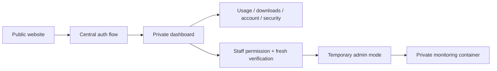

# Caller Whale web rebuild plan

Status: **Draft for review — planning only.** Created 2026-11-01.
No new UI, routes, infrastructure, security settings or deployments are implemented by this package.

## Purpose

Create a coherent public website and a useful private web dashboard. Visitors should understand the product and its actual availability; customers should reach their next task without navigating marketing content. Improve existing useful work and shipped screenshots before replacing it.

This is the entry point for web experience planning. Existing feature documents remain the authority for product scope and pricing; existing auth/gateway plans remain references for current service contracts. Conflicts are recorded and resolved before implementation.

## Recommended approach

- Keep public pages and account pages on https://callerwhale.com initially. Separate marketing and dashboard layouts, route bundles and navigation. No additional dashboard DNS or auth provider is needed to achieve this.
- Prerender public content. Serve private routes as a neutral shell with no account data in HTML; fetch authorized data after the session check. A shell is not access control: APIs enforce every permission.
- Keep React/Vite for the first implementation. Adopt a different rendering framework only if a measured requirement needs it; evaluate build/deploy cost before approving a switch.
- Keep central auth as the sole identity broker and Firebase consumer. The gateway checks requests and the destination service checks again.
- Keep admin mode inside the dashboard. No /admin page, public staff navigation, admin search results, or separate public Grafana hostname.
- Plan account management, usage and desktop access first. A browser CRM duplicating every desktop feature is a separate scope decision.
- Build one route registry for routing, titles, descriptions, canonical URLs, indexability, sitemap inclusion and navigation. A private staff capability registry must not be serialized into public search/navigation.

## Current source baseline

Inspected 2026-11-01; source evidence, not a fresh live service audit.

| Area | Current source | Implication |
| --- | --- | --- |
| Routes | landing/web/src/App.jsx has 12 named routes | Preserve existing URLs or specify individual redirects |
| Rendering | scripts/prerender.mjs independently repeats routes | Remove the duplicate list in implementation |
| Sitemap | Build emits public marketing URLs; excludes legal and account pages | Make inclusion an explicit per-route decision |
| Robots | Build emits Allow: / and a sitemap URL | Add route/header checks; robots is not authorization |
| Account UX | AccountPages.jsx holds sign-in, signup, verification and dashboard sections | Split by responsibility while keeping behavior covered |
| Human verification | Shared HumanCheck plus auth Siteverify validation | Reuse central enforcement; audit live configuration before enabling |
| API preflight | Gateway fix 2a0f62e permits preflights through core origin checks | Keep a regression test across browser, gateway and core |
| Documentation | landing/README.md still mentions /admin and browser Firebase | Correct these stale descriptions when implementing; do not copy them into the rebuild |

## Selected main visual direction

The owner selected **Precision Studio for property outreach**, combining Whale Studio's ivory/charcoal/peach continuity with Instrument's condensed typography, precise grids and architectural imagery layered behind selected text. The later residential-property concept is the main reference. See the [selected direction and asset rules](05-selected-direction.md) and [full landing-page remake](pages/home.md).

This selects the visual direction for planning. Complete page layouts/copy and implementation still need acceptance checks; registration policy and feature readiness do not change.

### Earlier alternatives (superseded as the main recommendation)

| Direction | Public website | Dashboard | Trade-off |
| --- | --- | --- | --- |
| A — Product editorial (recommended) | Clear typography, real product screens, restrained charcoal and warm accent | Quiet navigation, useful tables, one dominant task per view | Strongest continuity with the existing useful design |
| B — Studio | Larger compositions, more image-led sections and deliberate motion | Compact control workspace with minimal decoration | More asset and responsive composition work |
| C — Utility | Short copy, direct feature/pricing comparisons | Dense controls and faster scanning | Less visual personality |

The earlier A/C recommendation is superseded by the selected direction. Light/dark share its typography, precise structure, property context and restrained peach accent.

Use the preserved selected reference rather than infer designs from older unavailable screenshots. Present full-height desktop/mobile light/dark compositions before extending the system across every page.

## Page register

Existing URLs remain until an approved replacement is ready. Proposed child routes do not yet exist.

| Page or state | URL | Status | Search | Plan |
| --- | --- | --- | --- | --- |
| Home | / | Existing | Index | [Home](pages/home.md) |
| Features | /features | Existing | Index | [Features](pages/features.md) |
| Pricing | /pricing | Existing | Index | [Pricing](pages/pricing.md) |
| Why Caller Whale | /compare | Existing | Index | [Comparison](pages/compare.md) |
| Public security | /security | Existing | Index | [Security](pages/security.md) |
| Contact | /contact | Existing | Index | [Contact](pages/contact.md) |
| Privacy | /privacy | Existing | Index; sitemap if substantive/current | [Privacy](pages/privacy.md) |
| Terms | /terms | Existing | Index; sitemap if substantive/current | [Terms](pages/terms.md) |
| Sign in | /signin | Existing | Noindex | [Sign in](pages/signin.md) |
| Sign up | /signup | Existing | Noindex | [Sign up](pages/signup.md) |
| Confirm email | /verify | Existing | Noindex | [Verification](pages/verify.md) |
| Forgot password | /forgot-password | Proposed | Noindex | [Recovery request](pages/forgot-password.md) |
| Reset password | /reset-password | Proposed; confirm actual email-link contract | Noindex | [Reset](pages/reset-password.md) |
| Dashboard overview | /dashboard | Existing | Noindex | [Overview](pages/dashboard.md) |
| Usage | /dashboard/usage | Proposed | Noindex | [Usage](pages/dashboard-usage.md) |
| Downloads | /dashboard/downloads | Proposed | Noindex | [Downloads](pages/dashboard-downloads.md) |
| Account | /dashboard/account | Proposed | Noindex | [Account](pages/dashboard-account.md) |
| Account security | /dashboard/security | Proposed | Noindex | [Account security](pages/dashboard-security.md) |
| Admin mode | Dashboard state; no /admin URL | Existing concept; re-audit enforcement | No public discovery | [Admin mode](pages/admin-mode.md) |
| Not found | Any unknown URL | Existing | Noindex; HTTP 404 | [Not found](pages/not-found.md) |

No speculative feature-detail, blog, billing or checkout routes are included. Add an individual plan and content owner before creating one.

## Shared plans

1. [Layouts, components and content](01-experience.md)
2. [Sitemap XML, robots.txt and search](02-discovery.md)
3. [Identity, human verification and privacy](03-security.md)
4. [Delivery, environments and acceptance](04-delivery.md)
5. [Selected visual direction and assets](05-selected-direction.md)

## Delivery order

1. Audit every current page/section with keep, improve or remake notes; inventory actual screenshots and contracts.
2. Resolve the decisions below; produce one home composition and one dashboard composition in light/dark, desktop/mobile.
3. Define tokens, layouts, route registry, navigation and interaction states.
4. Implement public pages and discovery files.
5. Implement sign-in, signup, verification and recovery against central auth.
6. Implement dashboard overview, usage, downloads, account and security.
7. Re-audit and integrate staff mode/private monitoring.
8. Run the full acceptance matrix, stage, release approved components, then verify production.

Each phase has a reviewable result. A design approval does not claim its API or deployment is verified.

## Decisions before implementation

| Decision | Proposal | Needed evidence |
| --- | --- | --- |
| Visual direction | Selected: Precision Studio + Whale Studio palette + layered property architecture | Direction selected; validate complete desktop/mobile light/dark compositions |
| Dashboard scope | Account, usage, download, security, admin | Explicit decision before adding the full browser CRM |
| Signup policy | Preserve invitation-only as baseline | Product decision before opening public signup; AUTH_DEV_TOKENS stays false |
| Session storage | Review current bearer/refresh design | Threat review of browser refresh storage; compare an HttpOnly web-session adapter and its service/CSRF cost |
| Staff factor | Require fresh strong verification per entry | Check whether current claims distinguish authenticator vs email; do not equate all factor methods |
| Recovery URLs | Proposed dedicated pages | Trace actual auth-issued email links and old-link compatibility |
| Pricing/checkout | Existing approved feature arithmetic, draft pricing labels | Feature approval; no payment UX until billing is implemented |
| Analytics | Minimal, consent-aware, no replay on account routes | Choose events/retention and resolve Cloudflare injection/CSP deliberately |

## Definition of complete

All page plans and shared acceptance checks are satisfied, evidence distinguishes mock/staging/live, redirects and discovery files are tested on the deployed build, and production monitoring shows no new auth/CORS/CSP failures. Until then the rebuild remains partial.
