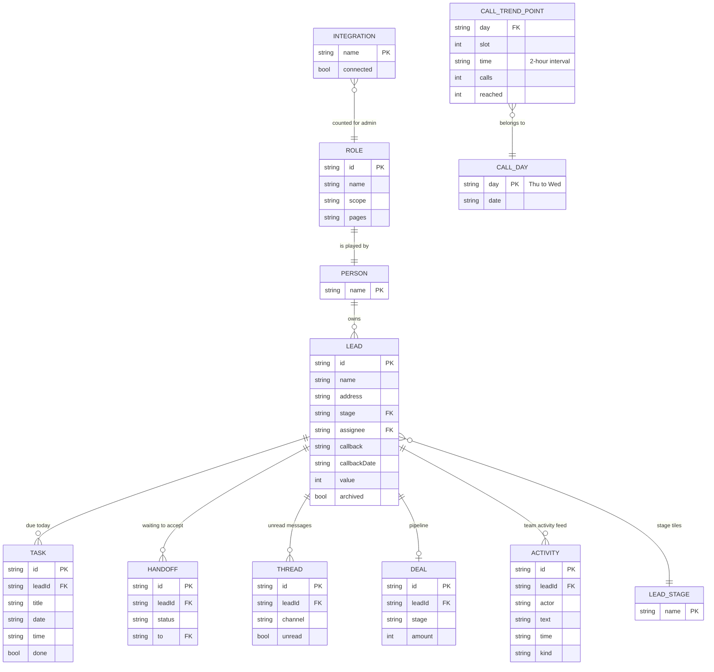

# Page 01 – Overview (`#/dashboard`)

Source: `src/Dashboard.jsx`, `src/CallActivityChart.jsx`. Every role has this page. The content changes by role: admin gets an access/services overview, client gets approved updates, everyone else gets "Needs you today", metrics, team activity and lead stages.

## ER diagram

## What each block shows

| Block | Entities | Fields used | Action |
| --- | --- | --- | --- |
| Needs you today | `TASK`, `LEAD`, `HANDOFF`, `THREAD` | `task.date/time/title`, `lead.callback`, `handoff.status`, `thread.unread` | opens lead, handoffs or inbox |
| Metrics (not admin) | `LEAD`, `TASK`, `DEAL` | counts by stage, open tasks, `deal.amount` (finance capability only) | – |
| Call activity chart | `CALL_TREND_POINT` (constant `CALL_TREND`, 42 points) | `day`, `time`, `calls`, `reached` | hover / keyboard |
| Lead stages | `LEAD`, `LEAD_STAGE` | count per stage | `work/leads?stage=` |
| Team activity | `ACTIVITY` | `actor`, `text`, `time`, `kind` | opens lead |
| Client "Approved updates" | `LEAD` (shared), `NOTE` (shared) | shared notes | opens lead |
| Admin overview | `INTEGRATION`, `ROLE` | connected count, 8 role presets, 6 services | settings links |

`CALL_TREND_POINT` is illustrative constant data, not stored in state.
