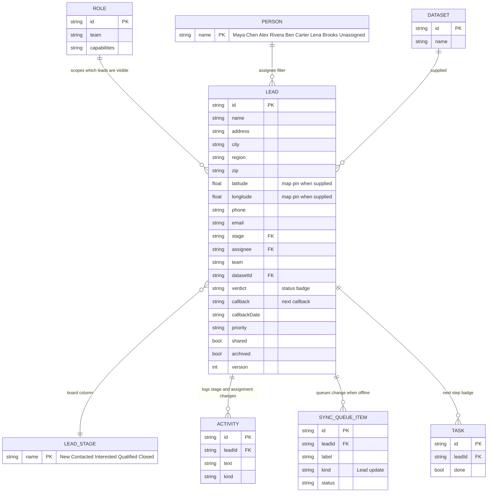

# Page 02 – Leads list (`#/work/leads`)

Source: `src/Leads.jsx` (`Leads`), `src/PropertyMap.jsx`. Views: **List**, **Board** (not for client) and **Map**. Filters: search text, stage (`?stage=`), assigned person (`?assignee=`), "hide empty", and show archived.

## ER diagram

## UI controls → data

| Control | Reads | Writes (reducer action) |
| --- | --- | --- |
| Search box | `lead.name/address/city/phone/email` | – |
| Stage filter, assignee filter | `lead.stage`, `lead.assignee` | – |
| Show archived | `lead.archived` | – |
| Stage drag on Board / keyboard stage change | `lead.stage` | `UPDATE_LEAD {change:{stage}}` → `lead.version+1`, new `ACTIVITY` |
| Bulk stage select | selected `lead.id` list | `UPDATE_LEAD` per lead |
| Bulk assign | `lead.assignee` | `UPDATE_LEAD {change:{assignee}}` (needs `assign` capability and being online) |
| Map view | `lead.latitude/longitude`, `address` (approximate area if no coordinates) | – |
| "New lead" button | – | navigates to [04-new-lead.md](04-new-lead.md) |
| Row click | – | opens [03-lead-detail.md](03-lead-detail.md) |

Visibility rule (`scopedLeads`): owner and solo see all; manager and researcher see their team; caller and closer see leads they are assigned or have an incoming handoff for; client sees `shared` leads only; admin sees none.
