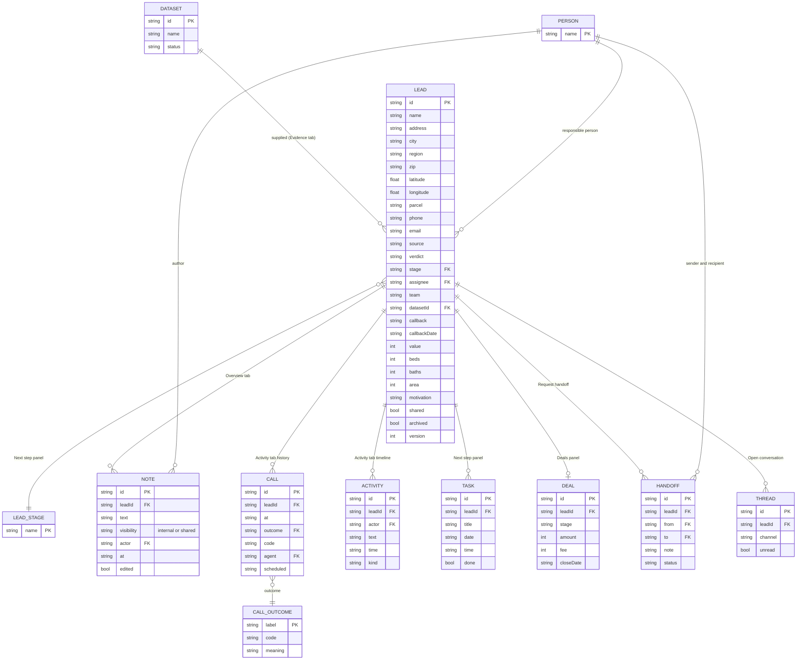

# Page 03 – Lead record (`#/work/leads/:id`)

Source: `src/Leads.jsx` (`LeadDetail`), `src/PropertyMap.jsx`. Tabs: **Overview, Activity, Location, Documents, Evidence** (client sees Overview, Location, Documents). Header has one primary action (Call) and a More menu (Create task, Request handoff, Open conversation, Archive, Delete permanently).

## ER diagram

## Tabs → data

| Tab / panel | Entities | Notes |
| --- | --- | --- |
| Header | `LEAD` | name, address, city/region, stage, archived badge; "linked to N lead record" counts leads with the same `name` |
| Overview | `LEAD`, `NOTE`, `THREAD` | property facts (`beds`, `baths`, `area`, `value`), `motivation`, contact, assignee/team. Client sees "Approved property context" and shared notes only |
| Notes composer | `NOTE` | visibility select (internal/shared); client always writes `shared` |
| Activity | `CALL`, `ACTIVITY`, `NOTE`, `HANDOFF` | "The full lead history": calls with outcome code, agent, scheduled retry |
| Location | `LEAD` | `PropertyMap` with the single lead |
| Documents | `LEAD` | approved property brief (print), generated from address fields; no stored document table |
| Evidence | `DATASET`, `LEAD.source`, `LEAD.verdict` | phone and source evidence, link to the source list |
| Next step panel | `LEAD`, `TASK` | stage, callback date, callback time, responsible person; open tasks for this lead |
| Deals panel | `DEAL` | list of deals, "New deal" (see [06-deals.md](06-deals.md)) |
| Contact panel | `LEAD` | phone, email, links to Calls and Inbox |
| Handoff modal | `HANDOFF` | "Send to" + "Qualification & seller context" |

## Actions → reducer

| UI action | Action type | Effect |
| --- | --- | --- |
| Change stage / callback / responsible person | `UPDATE_LEAD` | updates `LEAD`, `version+1`, new `ACTIVITY` |
| Add note | `NOTE` | appends to `lead.notes`, new `ACTIVITY` (kind Note) |
| Edit / delete note, Undo | `EDIT_NOTE`, `DELETE_NOTE`, `RESTORE_NOTE` | author or editor only |
| Request handoff | `HANDOFF` | new `HANDOFF` (Requested). One open handoff per lead |
| New deal | `NEW_DEAL` | new `DEAL` (finance capability) |
| Archive / Restore | `ARCHIVE_LEAD`, `RESTORE_LEAD` | sets `lead.archived` (Undo in toast) |
| Delete permanently | `DELETE_LEAD` | only if archived. Cascades: deals, tasks, threads, handoffs, activities, queue items |
