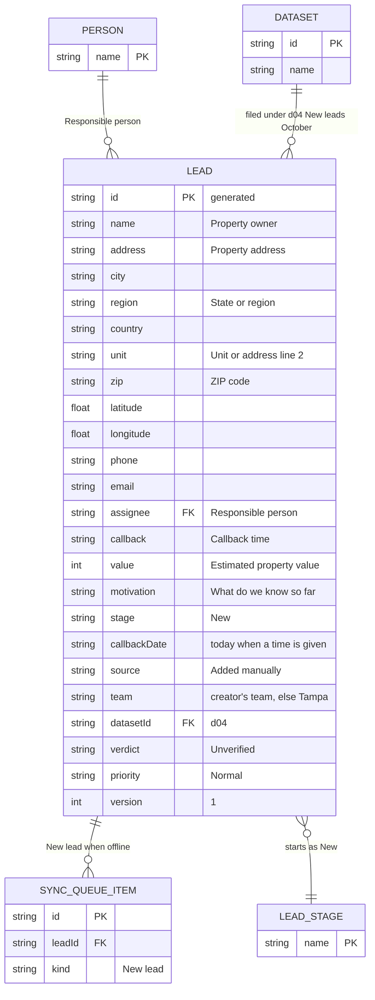

# Page 04 – New lead (`#/work/leads/new`)

Source: `src/Leads.jsx` (`NewLead`). Needs the `edit` capability. One form, one new `LEAD`.

## ER diagram

## Form field → LEAD column

| Form label | Input name | Column |
| --- | --- | --- |
| Property owner | `name` | `lead.name` |
| Property address | `address` | `lead.address` |
| City | `city` | `lead.city` |
| State / region | `region` | `lead.region` |
| Country | `country` | `lead.country` |
| Unit / address line 2 | `unit` | `lead.unit` |
| ZIP code | `zip` | `lead.zip` |
| Latitude / Longitude | `latitude`, `longitude` | `lead.latitude`, `lead.longitude` (validated by `coordinates()`; invalid values are not pinned) |
| Phone | `phone` | `lead.phone` |
| Email | `email` | `lead.email` |
| Responsible person | `assignee` | `lead.assignee` |
| Callback time | `callback` | `lead.callback` |
| Estimated property value | `value` | `lead.value` |
| What do we know so far? | `context` | `lead.motivation` |

Defaults set by the code, not by the form: `stage` New, `source` "Added manually", `datasetId` `d04`, `verdict` Unverified, `priority` Normal, `shared` false, empty `calls` and `notes`, `beds` 3, `baths` 2, `area` 1600. The assignee defaults to the signed-in person.

Action: `NEW_LEAD` appends the lead; when offline it also adds a `SYNC_QUEUE_ITEM`. No note, task or activity row is created. The page then opens the new lead record.
