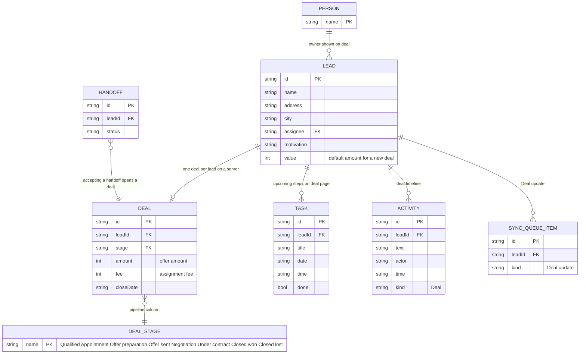

# Page 06 – Deals (`#/work/deals`, `#/work/deals/:id`)

Source: `src/Work.jsx` (`Deals`). Roles with the page: owner, manager, closer, solo. Amounts and fees need the `finance` capability. Views: **Pipeline** (columns per stage) and **List**. Opening a deal shows its detail with an inline editor.

## ER diagram

## UI → data

| Element | Fields | Action |
| --- | --- | --- |
| Pipeline column | `deal.stage` | stage select → `DEAL {change:{stage}}`, an `ACTIVITY` is added only for stage moves |
| Deal card | `lead.address`, `lead.name`, `deal.amount`, `deal.fee`, `deal.closeDate` | opens `work/deals/:id` |
| Deal detail header | `lead.address`, `lead.name`, `deal.stage` | – |
| Amount / Fee / Close date inputs | `deal.amount`, `deal.fee`, `deal.closeDate` | `DEAL` (quiet edit, no activity) |
| Upcoming steps | `TASK` for the lead (open) | – |
| Timeline | `ACTIVITY` for the lead | – |
| New deal modal (opened from a lead) | `stage`, `closeDate`, `amount`, `fee`, lead select | `NEW_DEAL` |
| Delete deal | – | `DELETE_DEAL` after confirmation; permanent |
| Summary strip | Active pipeline = sum of `deal.amount` for stages not starting with "Closed"; Expected fees = sum of `deal.fee`; Under contract = count of that stage | – |
| New deal button (list page) | opens the same modal; hidden on a server when every visible lead already has a deal | `NEW_DEAL` |

Accepting a handoff (see [07-handoffs.md](07-handoffs.md)) creates a deal with stage Qualified, `amount` = `lead.value`, `fee` 0, `closeDate` `2026-11-15` when the lead has none.
