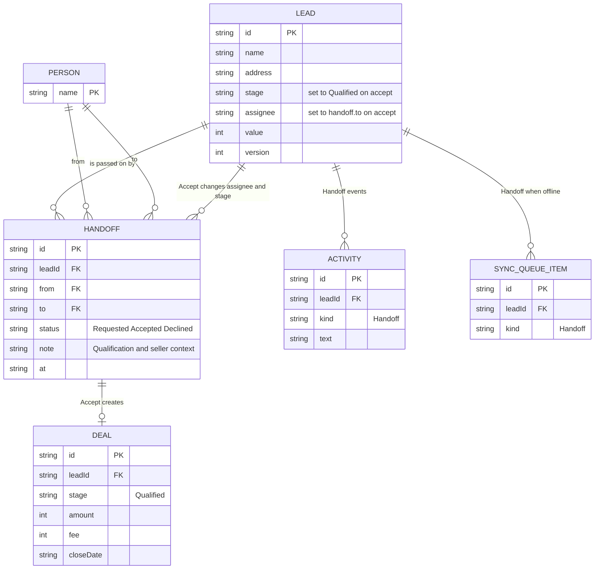

# Page 07 – Handoffs (`#/work/handoffs`)

Source: `src/Work.jsx` (`Handoffs`). A handoff passes a lead from one person to another with qualification context. Filter: All / Requested / Accepted / Declined.

## ER diagram

## Rules in the reducer

| Action | Allowed when | Effect |
| --- | --- | --- |
| `HANDOFF` (from lead page modal) | person can edit the lead, has `handoff`, note is not empty, no other Requested handoff exists for the lead | new `HANDOFF` Requested; `ACTIVITY` "Requested a handoff to …" |
| `ACCEPT` | online, has `accept`, handoff is Requested, and person is the recipient (or manager/owner/solo) | `status` → Accepted, `lead.assignee` → `to`, `lead.stage` → Qualified, new `DEAL` if the lead has none, `ACTIVITY` |
| `ACCEPT` with `decline` | same checks | `status` → Declined, lead unchanged |

## UI → data

| Element | Fields |
| --- | --- |
| Row | `lead.name`, `lead.address`, `handoff.from` → `handoff.to`, `handoff.note`, `handoff.at`, `handoff.status` badge |
| Accept / Decline buttons | `ACCEPT` action, shown for Requested items the person may decide |
| Open lead link | `work/leads/:leadId` |
| Count in sidebar / top bar | `Requested` handoffs on visible leads |

Caller visibility: an incoming Requested handoff makes the lead visible to the recipient even if they are not yet its assignee.
