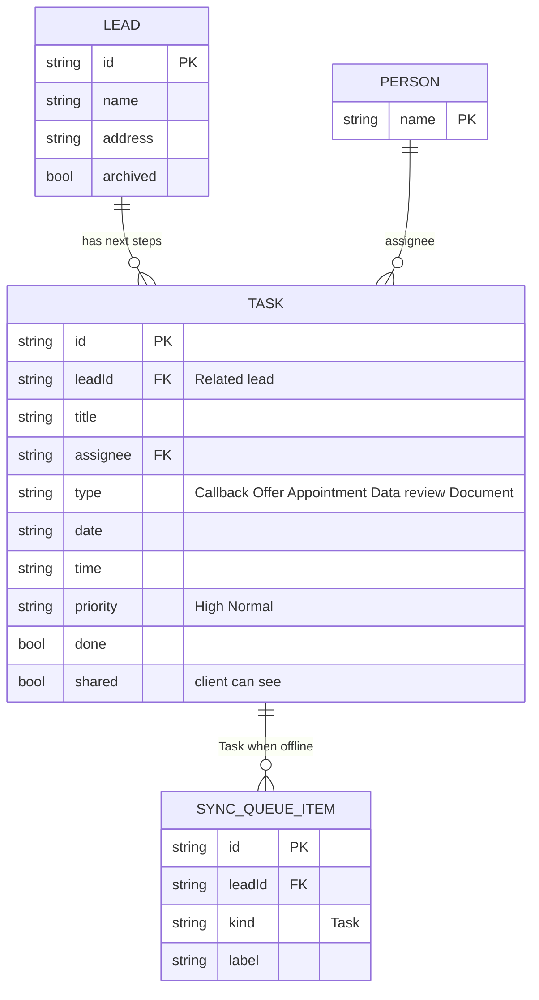

# Page 08 – Tasks (`#/work/tasks`, `#/work/tasks/new`)

Source: `src/Work.jsx` (`Tasks`). Filters: Open / Completed / All, search by title, and URL filters `?mine=1`, `?lead=:id`, `?assignee=:name`. Needs `edit` or `review` capability to create, edit, complete or delete. A client only sees tasks marked `shared`.

## ER diagram

## Form fields (new task and edit task)

| Label | Input name | Column |
| --- | --- | --- |
| Title | `title` | `task.title` |
| Related lead | `lead` | `task.leadId` (visible leads only, shown as name + address) |
| Assigned to | `assignee` | `task.assignee` |
| Type | `type` | `task.type` |
| Date | `date` | `task.date` |
| Time | `time` | `task.time` |
| Priority | `priority` | `task.priority` |

## Actions

| UI | Action | Effect |
| --- | --- | --- |
| Create | `TASK {task}` | new `TASK`, `done` false |
| Tick complete | `TASK {id}` | toggles `task.done` |
| Save edit | `UPDATE_TASK` | trims and updates title, date, time, assignee, priority, type |
| Delete | `DELETE_TASK` | removed at once with Undo in the toast |
| Undo delete | `RESTORE_TASK` | puts the task back |

Tasks are also created by other pages: a Callback outcome on [05-calls.md](05-calls.md) and a Transfer both add tasks. The list is the source for the bell and for [09-calendar.md](09-calendar.md).
