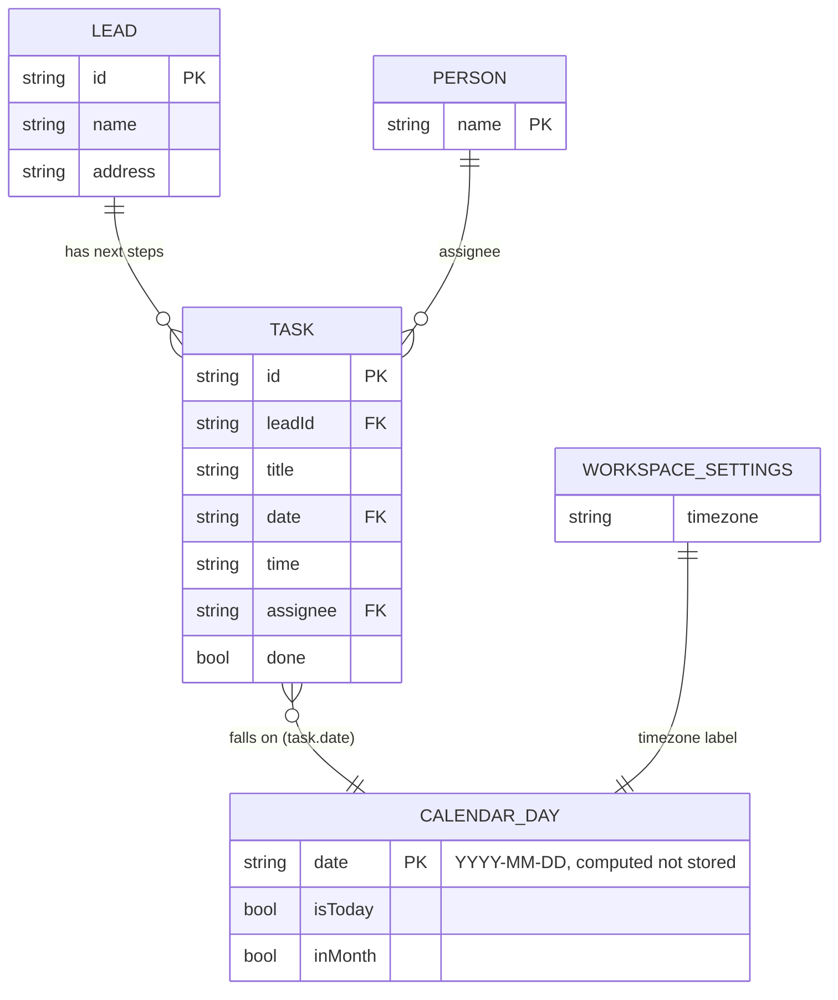

# Page 09 – Calendar (`#/work/calendar`)

Source: `src/Work.jsx` (`Calendar`). A month grid (6 weeks, Monday first) of open tasks. Local UI state: month, year and selected day. Timezone label comes from workspace settings.

## ER diagram

## UI → data

| Element | Data |
| --- | --- |
| Month grid cell | count of open `TASK` where `task.date` equals the cell date |
| Selected day panel | open tasks that day sorted by `task.time`: `title`, `time`, `assignee`, lead link |
| Complete button | `TASK {id}` toggles `done` |
| New task button | goes to [08-tasks.md](08-tasks.md) new-task form |
| Today button | resets to October 2026 and `TODAY` (2026-10-15) |
| Previous / next month | local state only |

The calendar has no event table of its own. Appointments are tasks of type Appointment.
