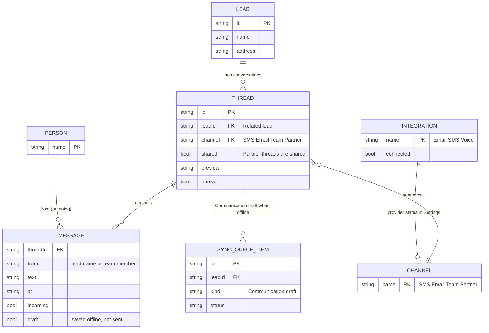

# Page 10 – Inbox (`#/work/inbox`, `?lead=:id`)

Source: `src/Work.jsx` (`Inbox`). Conversations per lead. Needs `message` or `publicComment` to write. Channels: All, SMS, Email, Team, Partner. A client only sees threads with `shared: true`, and can only start Partner threads. No real message is sent.

## ER diagram

`MESSAGE` rows are stored inside `thread.messages`. `CHANNEL` is a fixed list in the UI (Partner and Team have no matching `INTEGRATION`).

## UI → data

| Element | Fields | Action |
| --- | --- | --- |
| Channel tabs | `thread.channel` | filter only |
| Thread list row | `lead.name`, `thread.preview`, `thread.channel`, `thread.unread` | click selects and runs `MARK_READ` |
| Conversation | `thread.messages[]`: `from`, `text`, `at`, `incoming`, `draft` | – |
| Composer (text + attach file name) | text, attachment file name (name only, nothing stored) | `MESSAGE` → appends message, sets `preview`, clears `unread`. Offline: message is a draft ("Offline draft") and a `SYNC_QUEUE_ITEM` is queued |
| New conversation modal | Related lead, Channel | `NEW_THREAD`: new empty `THREAD` (client forced to shared Partner) |
| Unread count | threads with `unread` | shown in sidebar, top bar and bell |
