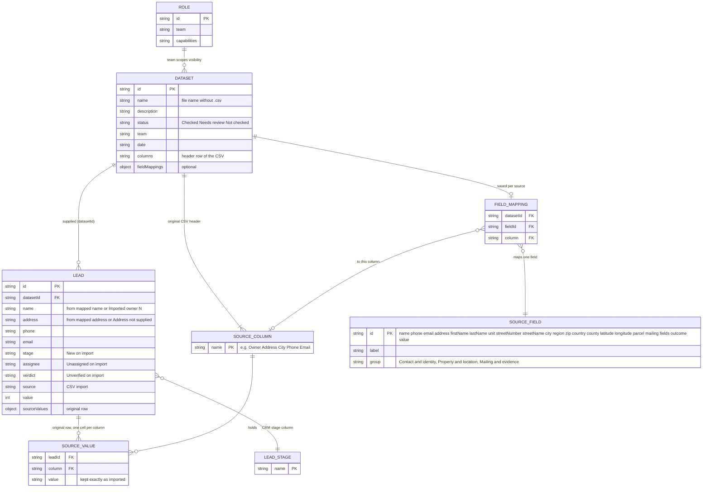

# Page 11 – Source lists (`#/lists`, `#/lists/:datasetId`)

Source: `src/DataPages.jsx` (`Lists`), `src/PropertyMap.jsx`. Roles with the page: owner, manager, researcher, solo. Importing needs the `import` capability. Original CSV values are kept in `lead.sourceValues` and never edited.

## ER diagram

## UI → data

| Element | Fields | Action |
| --- | --- | --- |
| Lists grid cards | `dataset.name`, `description`, `status`, `team`, `date`, record count | opens `lists/:id` |
| Import CSV button / file picker | CSV text via PapaParse (header row required) | `IMPORT`: one `DATASET` + up to 200 new `LEAD` rows |
| Try a sample import | 2 rows, columns Owner, Address, City, Phone, Email | `IMPORT` |
| Import errors | non-`.csv`, larger than 2 MB, parse error, no data rows | message only |
| List page header | `dataset.name`, visible record count | – |
| Export view | `dataset.columns` values via `sourceValue()` + CRM stage | CSV download, needs `export` |
| Call this list | – | `work/calls?list=:id`, needs `call` |
| Open in Skip Tracing | – | `skip?list=:id`, needs `review` or `import` |
| Context strip | `dataset.status`, `dataset.team`, column names | – |
| Source list map | `lead.latitude/longitude` or address area | see map rules in AGENTS.md |
| Table | owner (`LeadLink`), `address`, `city`, `region`, `phone` (or "No phone supplied"), `verdict`, `stage` | row opens the lead |

Visibility: a dataset is listed if the person can see at least one of its leads, or if they have `import` and the dataset belongs to their team.
