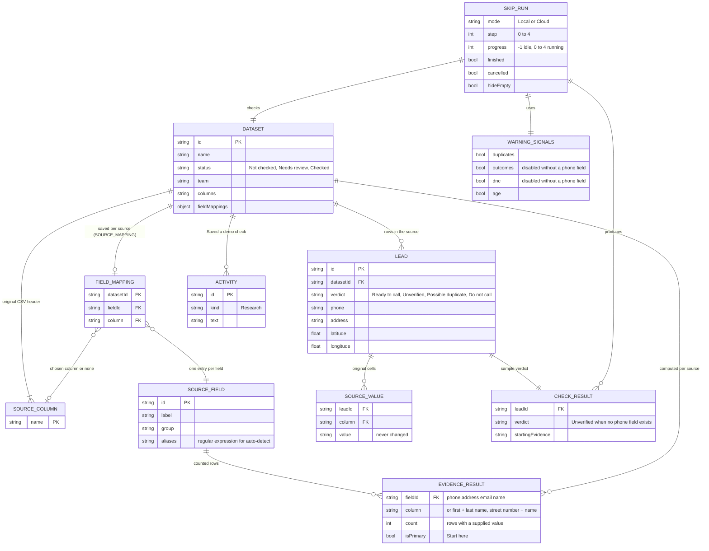

# Page 12 – Skip Tracing (`#/skip`, `?list=:datasetId`)

Source: `src/DataPages.jsx` (`SkipTracing`), `src/SourceFieldMapping.jsx`, `src/skiptrace-fields.js`, `src/PropertyMap.jsx`. Roles with the page: owner, researcher, solo. Needs `review` or `import`. Five steps: **Source fields → Call outcomes (only when a populated phone field exists) → Warning signs → Results → Save a copy**. The check is a timed UI simulation; nothing runs in the background.

## ER diagram

`SKIP_RUN`, `WARNING_SIGNALS`, `EVIDENCE_RESULT` and `CHECK_RESULT` are page state or computed values; they are not saved. Only `DATASET.fieldMappings` (via `SOURCE_MAPPING`), `DATASET.status` (via `CHECK`) and the `ACTIVITY` row are saved.

## Evidence order

The first field with at least one supplied value becomes the starting evidence: **Phone → Address → Email → Owner name**. Coordinates count as a fallback ("Latitude + longitude"). A value is not "supplied" if it is empty, n/a, none, null, unknown, "Address not supplied", "Imported owner N" or "-". If there is no populated phone field, the Call outcomes step is hidden, the outcomes and do-not-call signals are disabled, and every verdict except existing Do not call / Possible duplicate shows as Unverified.

## Steps → data

| Step | Fields | Action |
| --- | --- | --- |
| Source select | `DATASET` list the person can see | resets overrides and the run |
| 1 Source fields | `SOURCE_FIELD` ↔ `SOURCE_COLUMN` mapping grid grouped as Contact & identity, Property & location, Mailing & evidence; original-value preview table with "hide empty columns" | `SOURCE_MAPPING` saves per source |
| 2 Call outcomes | imported call-status field select; preview of Reached, No answer / voicemail, Wrong number, Do not call | local override (`outcome`) |
| 3 Warning signs | four signal switches | – |
| Run demo check | needs a primary evidence field; Cloud mode needs a connection | starts the 5-stage simulated job: Reading source rows, Reviewing evidence, Comparing candidate pairs, Building lead groups, Preparing the review |
| 4 Results | counts of rows, Ready to call, possible repeats; one row per lead with verdict | review opens the lead |
| 5 Save a copy | – | `CHECK` sets `DATASET.status` to Checked and adds an `ACTIVITY`; or export CSV (`columns` + Sample verdict + Starting evidence) |
| Source location map | `lead.latitude/longitude`, mapped coordinate fields | supplied coordinates versus approximate areas |
| Check context / Evidence order cards | source name, row count, starting evidence, execution mode | – |
