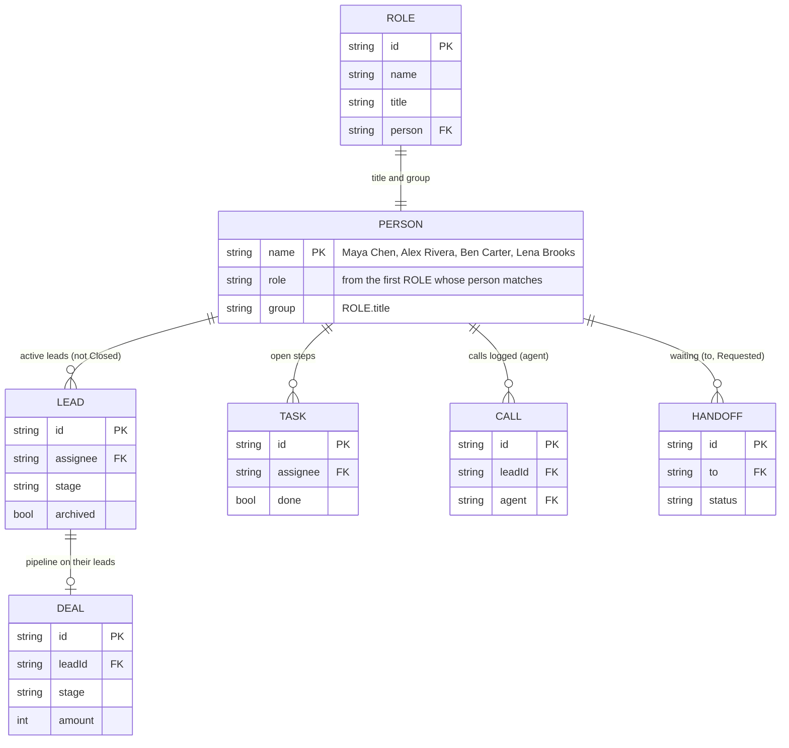

# Page 13 – Team (`#/team`)

Source: `src/Team.jsx`. Roles with the page: owner, manager. Read-only; every number is computed from other entities, nothing is stored.

## ER diagram

## Metrics per person

| Card value | Calculation |
| --- | --- |
| Active leads | visible leads, stage ≠ Closed, `assignee` = person |
| Open steps | visible tasks, not done, `assignee` = person |
| Calls logged | `lead.calls` entries on visible leads where `agent` = person |
| Handoffs waiting | handoffs with `to` = person, status Requested, on a visible lead |
| Pipeline on their leads | sum of `deal.amount` for their active leads, stage not starting with "Closed". Shown only with `finance` |

Page-level tiles: People (4), Active leads (sum), Open next steps (sum), Unassigned (visible active leads with no assignee or "Unassigned"; links to `work/leads?assignee=Unassigned`).

Links out: See leads → `work/leads?assignee=:name`, See tasks → `work/tasks?assignee=:name`, Handoffs waiting → `work/handoffs`.
