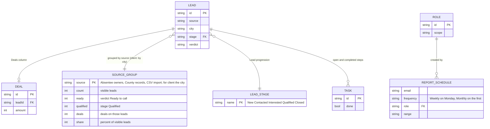

# Page 14 – Reports (`#/reports`)

Source: `src/Management.jsx` (`Reports`). Roles with the page: owner, manager, closer, researcher, client, solo. All figures are computed from the records the person can see. The period selector ("This week", "This month", "All time") is a layout preview; totals always show the current snapshot.

## ER diagram

`SOURCE_GROUP` is computed, not stored. `REPORT_SCHEDULE` is saved in state (`reportSchedules`), is local only, and sends nothing.

## Blocks → data

| Block | Calculation | Visible to |
| --- | --- | --- |
| Metric tiles | Visible leads (client: "Shared properties"), Qualified, Open next steps, Recorded pipeline = sum of `deal.amount` (without `finance`: Completed next steps) | all |
| Source effectiveness table | per source: count, Ready to call (hidden for client), Qualified, Deals (needs `finance`), share meter | all (client sees "Shared property locations" by city) |
| Export CSV | same rows | `export` capability |
| Lead progression | count and meter per `LEAD_STAGE` | all |
| Scheduled reports / What this report includes | `reportSchedules` list; others see a text about scope | `finance` sees the list |
| Schedule report modal | Recipient email, Frequency | `REPORT_SCHEDULE`, `finance` |
| Print / save PDF | `window.print()` | all |
