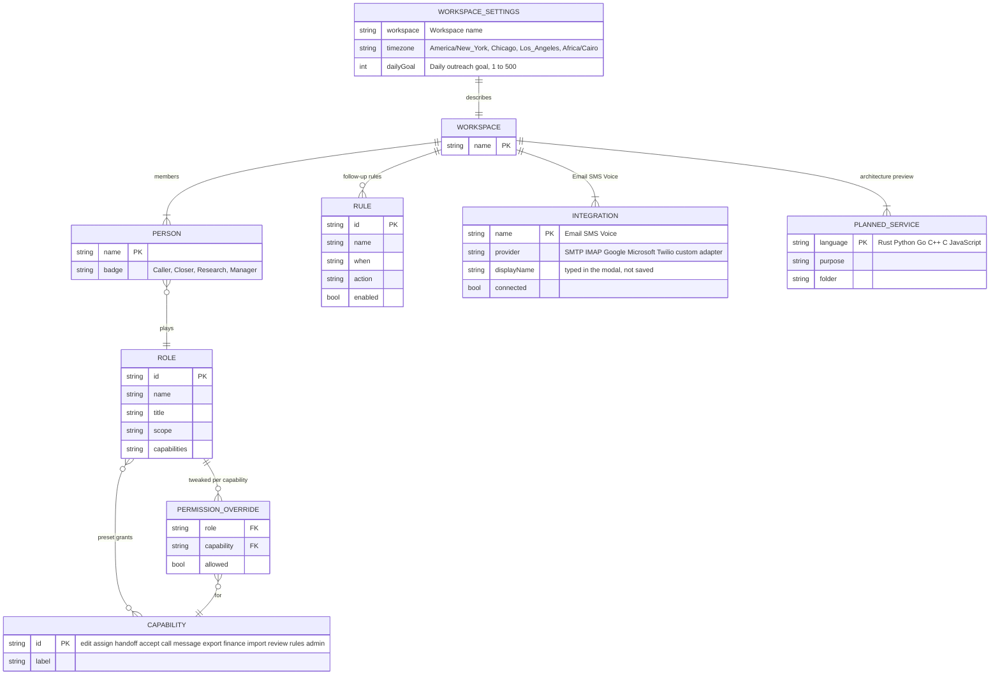

# Page 15 – Settings (`#/settings/:section`)

Source: `src/Management.jsx` (`Settings`). Roles with the page: owner, manager, admin, solo. Sections depend on capabilities: **Workspace** (everyone with the page), **Follow-up rules** (`rules`), and with `admin`: **People & permissions**, **Communication**, **Services & storage**. The Caller Whale logo menu also links here.

## ER diagram

`CAPABILITY`, `PLANNED_SERVICE` and the member list are fixed lists in the UI, not editable rows.

## Sections → data

| Section | Elements | Action |
| --- | --- | --- |
| Workspace | form: Workspace name, Display timezone, Daily outreach goal; member list of four people with role badges | `SETTINGS` (needs `admin` or `rules`) |
| Follow-up rules | one row per `RULE` (name, When, Then), switch Enabled/Paused, Preview rule (message only, nothing runs) | `RULE` toggles `enabled` (needs `rules`) |
| People & permissions | role preset select (all 8 roles), scope card, 12 capability checkboxes | `PERMISSION` writes a `PERMISSION_OVERRIDE`; the checkbox shows the override, else the preset |
| Communication | three cards (Email, SMS, Voice) with provider text and status badge; modal with display name and provider | `INTEGRATION` sets `connected`; no credentials are sent or stored |
| Services & storage | six planned language services, PostgreSQL card, Redis card | read-only |

The 12 capability labels: Edit visible leads, Assign responsibility, Request handoffs, Accept handoffs, Work calling queue, Use conversations, Export visible records, View deal financials, Import source data, Review Skip Tracing, Configure rules, Administer workspace.

Settings are local-only actions: `SETTINGS`, `INTEGRATION`, `PERMISSION` and `RULE` never reach the server in connected mode.
