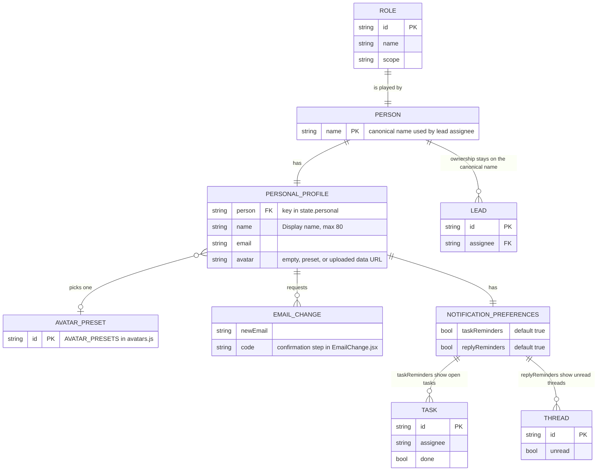

# Page 17 – My account (`#/personal/profile`, `#/personal/preferences`)

Source: `src/Personal.jsx`, `src/EmailChange.jsx`, `src/avatars.js`. Opened from the avatar menu (My profile, Notification preferences). The avatar menu also links to My tasks (`work/tasks?mine=1`) and My calendar when the role has them. Every role can open it.

Personal settings are saved per **display name of the sample account** (`state.personal[person]`) and stay on this device. In connected mode `PERSONAL` is a local-only action.

## ER diagram

## Profile tab

| Element | Data | Action |
| --- | --- | --- |
| Avatar grid | default initial avatar + presets + uploaded photo | `PERSONAL {avatar}`. Upload is resized to a square data URL in the browser (`squareAvatar`) |
| Display name | `profile.name` | `PERSONAL {name}`. Does not change `assignee` on leads |
| Contact email | `profile.email` (default `first.last@example.com`) | change flow in `EmailChange` (confirmation step) |
| Your workspace identity card | name, email, role name, `settings.workspace`, `role.scope` | read-only |

## Preferences tab

| Switch | Field | Effect |
| --- | --- | --- |
| Task reminders | `taskReminders` | bell panel lists open tasks |
| Unread conversations | `replyReminders` | bell panel lists unread threads (only if the role has Inbox) |

Preferences control in-app notices only. No email or SMS is sent.
