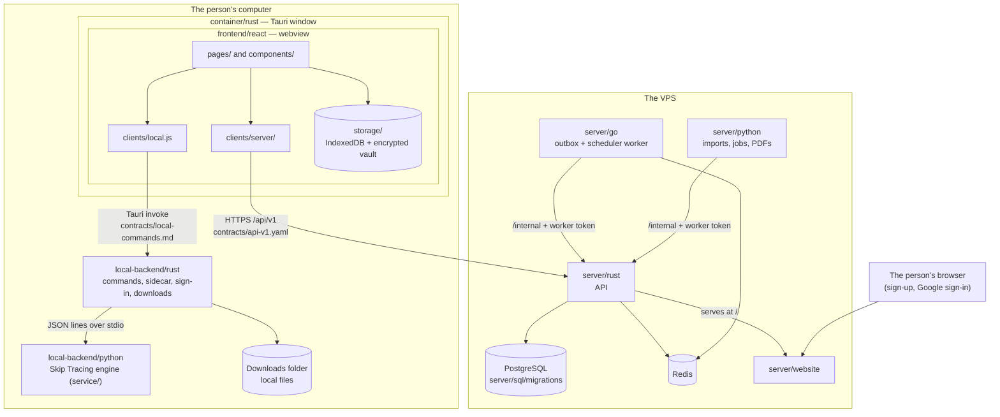
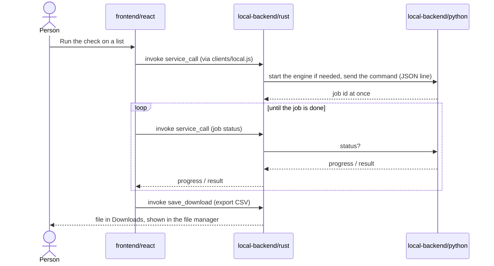
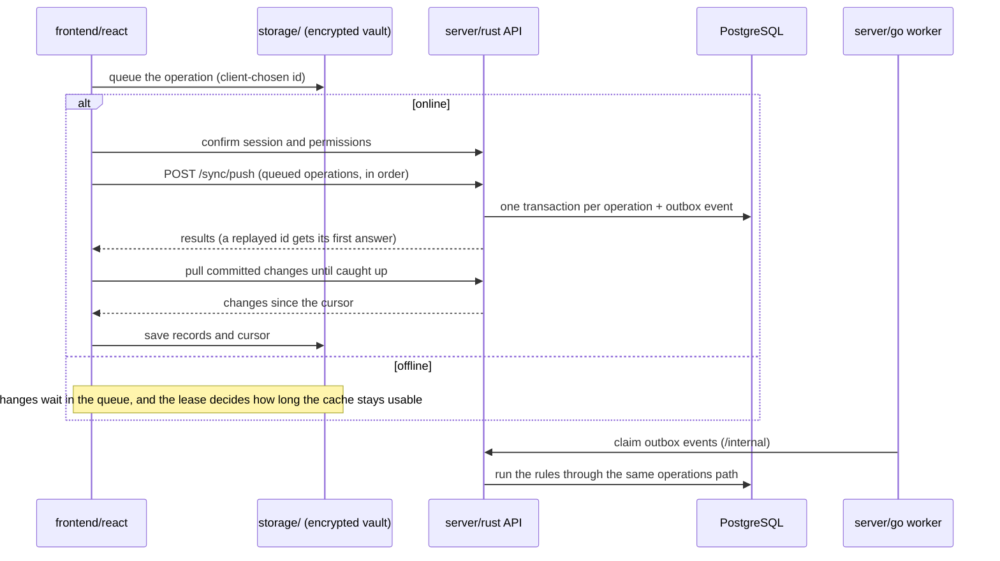
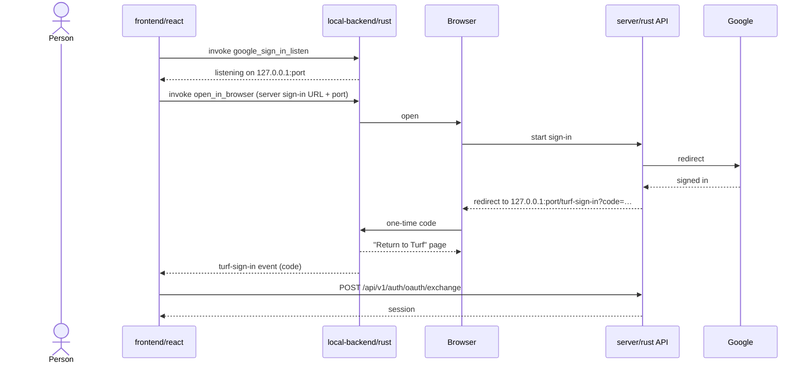

# ADR-001: The structure of Full CRM Turf

**Status:** Proposed
**Date:** 2026-10-24
**Deciders:** Mohammed Hesham, Magdy

Read this before changing anything in `Full CRM Turf/`. It says which part of the product each piece of code belongs to, which folder it lives in, and how the parts may talk to each other. Code that does not fit one of the four parts below does not get merged until this document says where it goes.

## Context

Full CRM Turf began as a frontend-only demo (a Vite + React site on Vercel). It then grew a Tauri desktop host, a Python Skip Tracing engine, a Rust API, a Go worker, a Python worker, a website and Google sign-in. Each piece was added beside the last one, so today the folder mixes all of them:

- `src/` holds 38 React and JavaScript files side by side (screens, the state model, the API client, the sync engine, the encrypted cache, the engine client). Several files are 1,000+ lines (`Work.jsx`, `Leads.jsx`, `ui.jsx`, `DataPages.jsx`).
- `src-tauri/` is both the desktop container and the local backend (the Python bridge, sign-in, downloads).
- `backend/` is the VPS server, but `website/`, `contracts/` and `docs/saas/` sit next to it instead of inside it.
- The local engine the desktop app runs is `service/` at the repository root. It is shared with the Turf desktop app.
- Demo-only files (`vercel.json`, `worker/`, `.vercelignore`, `scripts/prepare-sites-build.mjs`, `screenshots/`) are mixed in with the product.

Nobody can tell from the tree where new code belongs, which is a large part of why the app neither looks nor works consistently.

## Decision

Full CRM Turf has **four parts**. Each part is a top-level folder, and inside each part **every language has its own folder**.

| Part | Folder | Runs where | Languages |
| --- | --- | --- | --- |
| 1. The Rust container | `container/` | The person's computer: the desktop window | Rust |
| 2. The frontend of the container | `frontend/` | Inside the container's webview (and, for the demo, a browser tab) | JavaScript / React, CSS |
| 3. The backend inside the container | `local-backend/` | The person's computer, started by the container | Rust, Python |
| 4. The backend on the VPS server | `server/` | The Hostinger VPS | Rust, Go, Python, SQL, plus the static website |

Shared definitions between the parts live in `contracts/`. Design notes live in `docs/`.

### Target tree

```text
Full CRM Turf/
├── container/                    1. THE RUST CONTAINER (Tauri 2)
│   └── rust/                        The desktop shell only: window, title bar, menus, capabilities,
│       ├── Cargo.toml               icons, packaging. Registers the local backend's commands.
│       ├── tauri.conf.json          No business logic here.
│       ├── capabilities/
│       ├── icons/
│       └── src/main.rs
│
├── frontend/                     2. THE FRONTEND OF THE CONTAINER
│   └── react/                       Everything the person sees. Talks to (3) and (4) only through
│       ├── package.json             the clients in src/clients/.
│       ├── vite.config.mjs
│       ├── index.html
│       ├── public/
│       └── src/
│           ├── app/                 Entry, routing, layout shell, sidebar, menus
│           ├── pages/               One folder per screen: dashboard/, leads/, calls/, data/,
│           │                        team/, management/, personal/ (each split into small files)
│           ├── components/          Shared UI: buttons, tables, cards, dialogs, maps, charts
│           ├── styles/              Design tokens and global CSS (one source of colours, spacing, type)
│           ├── state/               The CRM model and reducer, field vocabulary, sample data
│           ├── clients/
│           │   ├── local.js         Calls into the local backend (Tauri invoke / dev /rpc)
│           │   └── server/          VPS API client, sync engine, session, translation
│           └── storage/             IndexedDB workspace and the encrypted offline vault
│
├── local-backend/                3. THE BACKEND INSIDE THE CONTAINER
│   ├── rust/                        A library crate (turf-local) the container links in: the Tauri
│   │   ├── Cargo.toml               commands, the Python sidecar bridge, desktop sign-in, downloads,
│   │   └── src/                     local files. Every command the frontend may call is defined here.
│   │       ├── lib.rs
│   │       ├── commands.rs
│   │       ├── sidecar.rs
│   │       ├── signin.rs
│   │       └── downloads.rs
│   └── python/                      The Skip Tracing engine the sidecar runs (JSON lines over stdio).
│                                    Today this is the repository's shared service/ (see "Shared engine").
│
├── server/                       4. THE BACKEND ON THE VPS SERVER
│   ├── rust/                        Public API (Axum, sqlx): sign-in, MFA, permissions, CRM operations,
│   │   ├── Cargo.toml               sync, events, billing, OAuth. Owns the database.
│   │   └── crates/{api,grouping}/
│   ├── go/                          turf-worker: outbox events, scheduler, Redis invalidations
│   ├── python/                      turf_worker: imports, server-side Skip Tracing jobs, report PDFs
│   ├── sql/migrations/              PostgreSQL migrations (only server/rust applies them)
│   ├── website/                     The public sign-up / sign-in / account site the API serves at /
│   ├── scripts/                     Local dev: Postgres + Redis, run-api, run-worker, seed, admin
│   └── deploy/                      VPS setup: nginx, systemd units, environment templates
│
├── contracts/                    Shared definitions, never code that runs
│   ├── api-v1.yaml                  Frontend ↔ server API
│   ├── local-commands.md            Frontend ↔ local backend: every Tauri command and its payload
│   └── native/                      Native ABIs (grouping)
│
├── demo/                         The Vercel client demo only: vercel.json, .vercelignore, the Sites
│                                 worker, its build script. Deleting this folder must not break the product.
│
└── docs/                         Design QA, ER diagrams, SaaS notes, screenshots
```

### How the parts may talk



#### A Skip Tracing check (works offline)



#### A CRM change and sync



#### Desktop Google sign-in



Rules:

1. **The frontend never touches files, processes or the database.** It reaches the computer only through `clients/local.js`, and the server only through `clients/server/`. A screen never calls `fetch` or `invoke` itself.
2. **The container is a shell.** `container/rust` creates the window and registers commands. A command's logic lives in `local-backend/rust`.
3. **Every local command is listed in `contracts/local-commands.md`**, and every server route in `contracts/api-v1.yaml`. The existing contract test (`server/rust/crates/api/tests/contract.rs`) keeps the API honest. A matching test should keep the local command list honest.
4. **Only `server/rust` connects to PostgreSQL.** The Go and Python workers claim jobs through `/internal` with a worker token, as they do today.
5. **The local backend works offline.** It must never need the VPS to open a list, run a Skip Tracing check or export a file. Signing in and syncing are the only things that need the server.
6. **Demo code stays in `demo/`.** The product must build and run with `demo/` deleted.

### Shared engine

The Python Skip Tracing engine is `service/` at the repository root. Both the Turf desktop app and Full CRM Turf run it, and `server/python` imports its phone and status rules so that a list reads the same on a laptop and on the server. Until Turf and Full CRM Turf become one product, `service/` stays where it is, and `local-backend/python/` holds only a README that points to it. When they merge, `service/` moves to `local-backend/python/`.

### Languages by part

The CRM's planned features (calling, SMS and email, live captions, call transcription, Skip Tracing, matching, maps, reports) pull in many languages. Most of them arrive as **libraries we use**, not code we write. The rule: **a language gets its own folder only when we write and maintain code in it.** A library written in C or C++ is a dependency, not a folder.

**Status:** *Today* = already in the repo. *Planned* = already in [the CRM plan](docs/TURF_CRM_AND_PERFORMANCE_PLAN.md). *New* = found by the research below. *Optional* = only if that feature is approved.

#### 1. The Rust container: `container/`

| Language | We write | Status |
| --- | --- | --- |
| Rust | The window, menus, microphone permission handling for calls and captions, packaging | Today |
| JSON | `tauri.conf.json`, capabilities | Today |
| Swift, Kotlin | Mobile shell code (Tauri 2 mobile plugins), if a phone app for callers is approved. Folders: `container/swift`, `container/kotlin` | Optional |

#### 2. The frontend: `frontend/`

| Language | We write | Status |
| --- | --- | --- |
| JavaScript (React), moving to **TypeScript** | Every screen and client. Switch file by file as the screens are split: Turf's own app already uses TypeScript, and typed clients catch contract mistakes before they ship | Today, to change |
| CSS | Design tokens and styles | Today |
| HTML | `index.html` only | Today |

#### 3. The backend inside the container: `local-backend/`

| Language | We write | Status |
| --- | --- | --- |
| Rust | Commands, sidecar bridge, sign-in, downloads, **live captions** (Windows' own speech API or whisper.cpp), offline map tiles | Today + New |
| Python | Skip Tracing engine (`service/`): phone, status and owner rules | Today |
| SQL (SQLite) | Local job and workspace tables | Today |
| C++ | The batch matching kernel (plan 2.9), only if it passes its 20% speed gate. Folder: `local-backend/cpp` | Planned |

#### 4. The backend on the VPS: `server/`

| Language | We write | Status |
| --- | --- | --- |
| Rust | Public API, auth, permissions, sync, events, billing | Today |
| SQL + PL/pgSQL | Migrations and row security; the PostGIS TIGER geocoder for US addresses | Today + New |
| Go | Outbox and scheduler worker, notification fan-out | Today |
| Python | Imports, server Skip Tracing, report PDFs, **call transcription** (faster-whisper) | Today + New |
| TypeScript (Node) | Twilio voice and SMS, email (SMTP/IMAP, Google, Microsoft), webhook signature checks, opt-out sync. Folder: `server/typescript` | Planned |
| C++ | The same matching kernel as the desktop, shared | Planned |
| ~~C~~ | The plan's C media worker is **not needed**: run the FFmpeg program for conversion and waveforms instead of linking its C libraries | Dropped |
| HTML, CSS, JavaScript | `server/website` | Today |

#### Everywhere: configuration and tooling (no folder of their own)

| Language | Used for |
| --- | --- |
| YAML | GitHub Actions, Docker Compose, `contracts/api-v1.yaml` (OpenAPI) |
| Dockerfile, Caddyfile | `server/deploy/`: one image per server language, the HTTPS proxy |
| Bash, PowerShell | Dev scripts; Windows packaging and signing |
| TOML, JSON | Cargo, npm, Tauri settings |
| Markdown, Mermaid | Docs and these diagrams |

#### Libraries in other languages (dependencies, not folders)

| Need | Library | Its language | Called from |
| --- | --- | --- | --- |
| Phone parsing and validation | libphonenumber (`phonenumbers`, `rlibphonenumber`) | C++/Java, with ports | Python, Rust |
| Address parsing and normalization | libpostal | C | Python (`postal`) |
| Fuzzy name matching | RapidFuzz | C++ | Python |
| Transcription | whisper.cpp, faster-whisper (CTranslate2) | C++ | Rust (desktop), Python (server) |
| Audio conversion, waveforms | FFmpeg | C | Go or Python, as a program |
| Maps | Leaflet now; MapLibre GL + PMTiles for offline maps | JavaScript | Frontend |
| Geocoding | PostGIS TIGER geocoder | PL/pgSQL | `server/rust` |
| Voice and SMS | Twilio Voice JS SDK; Twilio iOS/Android SDKs if mobile | JS, Swift, Kotlin | Frontend, mobile shell |

#### What the research changed

1. **Live captions must move out of the webview.** `src/listen.js` uses the browser's Web Speech API. Chromium keeps that API out of embedded webviews, WebKit does the same for embedded WKWebViews, and a feature check can pass even though recognition never starts. The desktop app should send microphone audio to `local-backend/rust`, which uses Windows' continuous dictation API or whisper.cpp. No new language is needed.
2. **Calling in the desktop app needs microphone permission handling in Rust.** The Twilio Voice JS SDK asks for the microphone through `getUserMedia`, and WebView2 raises a permission request the host must answer. Tauri has recently exposed a permission handler with a microphone kind. Twilio does not list Tauri or WebView2 as supported, so test this early. The plan's fallback, a browser companion window, stays.
3. **Opt-out is decided by Twilio, not by us.** On 10DLC numbers Twilio handles STOP itself and blocks later sends. The TypeScript adapter mirrors that status into the CRM instead of reading keywords.
4. **Offline maps need a local tile file.** MapLibre GL with a PMTiles extract (a few MB for a county) works without a server. The local backend must serve range requests from that file.
5. **Transcription runtime depends on the machine:** faster-whisper on NVIDIA GPUs (the server), whisper.cpp on CPU-only and Apple machines (the desktop). Neither streams on its own, so live captions need chunking with voice-activity detection on top.
6. **Mobile is the only real source of new languages.** A caller app on phones means Swift and Kotlin plugin code plus Twilio's native Voice SDKs. Decide on it separately.

**Result: the languages we write are Rust, TypeScript, Python, Go and SQL.** C++ comes in only if the matching gate passes, and Swift and Kotlin only if mobile is approved. That is five today and at most eight. Writing C is dropped.

Sources: [Twilio Voice JS best practices](https://www.twilio.com/docs/voice/sdks/javascript/best-practices) · [Chromium: speech APIs kept out of WebView](https://issues.chromium.org/41172064) · [WebKit: speech recognition in WKWebView](https://bugs.webkit.org/show_bug.cgi?id=239816) · [Windows continuous dictation](https://learn.microsoft.com/en-us/uwp/api/windows.media.speechrecognition.speechcontinuousrecognitionsession.startasync?view=winrt-26100) · [faster-whisper](https://github.com/SYSTRAN/faster-whisper) · [Whisper streaming (ufal)](https://github.com/ufal/whisper_streaming) · [faster-whisper vs whisper.cpp (2026)](https://codersera.com/blog/faster-whisper-vs-whisper-cpp-speech-to-text-2026/amp/) · [libpostal Python bindings](https://www.pypi.org/project/postal) · [rlibphonenumber](https://awesome.ecosyste.ms/projects/github.com%2Fvloldik%2Frlibphonenumber) · [PostGIS TIGER geocoder](https://docs.pgedge.com/postgis/v3-5-5/postgis-extras/tiger-geocoder/) · [Twilio Advanced Opt-Out](https://support.twilio.com/hc/en-us/articles/360034798533) · [10DLC opt-out handling](https://www.rockrms.com/tech-bulletin/changes-to-rocks-sms-opt-inopt-out-handling) · [PMTiles with MapLibre](https://docs.protomaps.com/pmtiles/maplibre) · [Tauri 2 mobile plugins](https://v2.tauri.app/blog/roadmap-to-tauri-2-0/) · [Tauri webview permissions](https://gitverse.ru/githubmirror/tauri/content/dev/crates/tauri-runtime/src/webview_permissions.rs)

## Options considered

### Option A: Parts first, languages inside (chosen)

`container/`, `frontend/`, `local-backend/`, `server/`, each with `rust/`, `go/`, `python/` or `react/` inside.

| Dimension | Assessment |
| --- | --- |
| Complexity | Medium: a one-time move plus path fixes |
| Cost | About two days, mostly re-pointing configs and splitting large screens |
| Scalability | Good: a new part or a new language adds one folder in an obvious place |
| Team familiarity | High: matches how the team already talks about the app |

**Pros:** You can see where code runs (your computer or the VPS) from its path. Ownership is clear. Each part can be built, tested and deployed alone.
**Cons:** Rust is in three places (`container/`, `local-backend/`, `server/`), so a shared Rust helper needs a home of its own.

### Option B: Languages first

`rust/`, `go/`, `python/`, `js/` at the top, with the parts inside each.

| Dimension | Assessment |
| --- | --- |
| Complexity | Medium |
| Cost | About the same as A |
| Scalability | Poor: the desktop app and the server mix inside `rust/` and `python/` |
| Team familiarity | Low |

**Pros:** One toolchain per folder. A Rust workspace can cover everything.
**Cons:** The most important line in the product (what runs on the computer and what runs on the VPS) disappears from the tree.

### Option C: Keep today's layout and only split `src/`

| Dimension | Assessment |
| --- | --- |
| Complexity | Low |
| Cost | Under a day |
| Scalability | Poor |
| Team familiarity | Medium |

**Pros:** Cheapest option, and nothing has to be re-pointed.
**Cons:** The container and the local backend stay mixed, the demo stays mixed with the product, and the next feature lands wherever is convenient again.

## Trade-off analysis

A is chosen because what hurts today is not the toolchains but not knowing where code belongs and what may call what. A makes the computer/VPS line and the four parts visible in every path, and that is what the rules above need. The one real cost, Rust living in three places, is handled with a Cargo workspace at `Full CRM Turf/Cargo.toml` that lists `container/rust`, `local-backend/rust` and `server/rust`. That gives one lock file and one `cargo test --workspace` without mixing the folders.

## Consequences

- **Easier:** finding where a change goes; reviewing it (a PR that touches `frontend/` and `server/` is visibly a contract change); testing each part alone; deleting the demo.
- **Harder:** the first move re-points every config: `tauri.conf.json` (`frontendDist`, `devUrl`, the before-commands), the Vite root, `sidecar.rs`'s path to `service/`, `server/scripts/run-api.sh`'s website and `.env.local` paths, the contract test's path to `contracts/`, the Python worker's path to `service/`, `.gitattributes`, `.claude/launch.json`, and the Vercel project root.
- **To revisit:** where `service/` lives once Turf and Full CRM Turf merge; whether the frontend's sample data belongs in `demo/` instead of `state/`.

## Action items

1. [ ] Agree on this document (Mohammed, Magdy). Change **Status** to Accepted.
2. [ ] Move the demo files into `demo/` and point the Vercel project's root there. Check that the demo still deploys.
3. [ ] Split `src-tauri/` into `container/rust` (`main.rs`, config, capabilities, icons) and `local-backend/rust` (`sidecar.rs`, `signin.rs`, `downloads.rs` as a library crate). Add the Cargo workspace.
4. [ ] Move the React app into `frontend/react/`, then sort `src/` into `app/`, `pages/`, `components/`, `styles/`, `state/`, `clients/` and `storage/`. Route every `invoke` and `fetch` through `clients/`.
5. [ ] Break the 1,000+ line screens (`Work.jsx`, `Leads.jsx`, `ui.jsx`, `DataPages.jsx`) into one folder per page with small files, and move every colour, spacing and type value into `styles/` tokens. This is the step that fixes most of "doesn't look good".
6. [ ] Move `backend/` to `server/`, `backend/rust/migrations` to `server/sql/migrations`, and `website/` to `server/website`. Update `run-api.sh`, `db.rs`'s `migrate!` path, the contract test and the Python worker's path to `service/`.
7. [ ] Write `contracts/local-commands.md` (today: `service_call`, `google_sign_in_listen`, `open_in_browser`, `save_download`) and a test that compares it with the commands the container registers.
8. [ ] Add `server/deploy/` with the VPS setup now described in `docs/saas/README.md`.
9. [ ] Update `Full CRM Turf/README.md`, `server/README.md`, the root `README.md` and `.claude/launch.json` to the new paths. Run every part's tests: `npm test`, `cargo test --workspace`, `go test ./...`, pytest.
