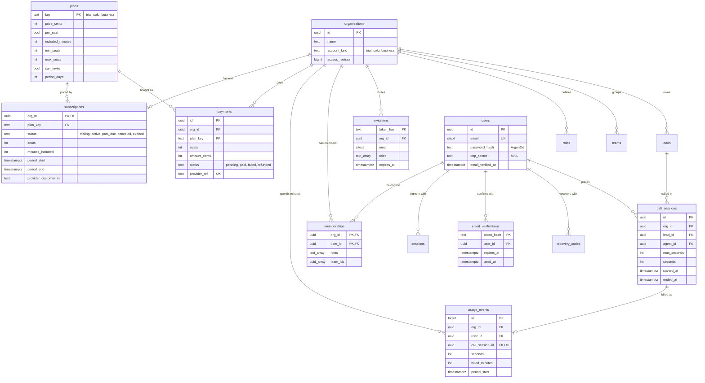

# Caller Whale as a paid service (SaaS)

Caller Whale is a CRM and a dialer for property outreach, sold as a service: people sign up on the website, try it on a short
trial, then pay for **Solo** (one person) or **Business** (a team with seats and roles). Nobody uses the app without
signing in, and the server enforces every limit.

Everything here runs on the existing Rust API and PostgreSQL (`backend/`), which suits a single Hostinger VPS.

## Plans

> Superseded: the tiers are now Free trial, Solo, Duo, Team and Pro, and prices are built from per-feature prices. See [the plans doc](../plans/README.md). The table below is what the server implements today.

| Plan | Price | Minutes | Seats | Team invitations | Period |
| --- | --- | --- | --- | --- | --- |
| Free trial | Free | 10 | 1 | No | 7 days |
| Solo operator | $149 / month | 5,000 | 1 | No | 30 days |
| Business | $129 per seat / month | 4,000 per seat, pooled | 2–500 | Yes, up to the seats paid for | 30 days |

Prices and minutes live in the `plans` table, so they change without a deploy. Business minutes are pooled: 3 seats
means 12,000 minutes shared by the team.

## How a customer moves through it

1. **Sign up** on the website (`/#/signup`): name, email, password (12+ characters), optional business name. This
   creates the user, a new organization, the role presets, the owner membership and a **trial** subscription.
2. **Protect the account.** Owners and administrators set up an authenticator code and get ten recovery codes.
3. **Confirm the email address.** This is required before buying a plan.
4. **Use the trial.** The CRM and Skip Tracing work; calls draw from the 10 minutes.
5. **Trial ends** (7 days, or the minutes are used up). CRM data requests answer `402 payment_required`. The website's
   account page and checkout still work, so the owner can pay.
6. **Checkout** records a pending payment and sends the browser to the payment provider. Only the provider's **signed
   webhook** marks it paid. That switches the plan, starts a new period with full minutes, and sets the seats.
7. **Business owners invite their team.** Each invitation has a role: manager, caller, closer, researcher,
   administrator or client. The role decides what that person can see and do. An open invitation holds a seat. When
   every seat is taken, inviting is refused until seats are added.

## Database (new tables in `backend/rust/migrations/0007_saas.sql`)

`plans` is shared reference data. Every other new table carries `org_id` under PostgreSQL row-level security, so one
organization can never read another's subscription, payments or usage. This is the same rule as every CRM table. The
existing CRM tables (`leads`, `contacts`, `properties`, `deals`, `tasks`, `notes`, `call_events`, `conversations`, …)
are unchanged.

### What is stored and what is not

| Stored | Not stored |
| --- | --- |
| Password hashes (Argon2id), never passwords | Card numbers or bank details: the payment provider keeps them |
| Hashes of session, invitation and verification tokens | The tokens themselves |
| One `usage_events` row per finished call (append-only) | Call lengths reported by the browser: the server times calls |
| Payments: plan, seats, amount, status, provider reference | Provider secrets in plain text (`integrations` holds ciphertext) |
| Subscriptions: plan, seats, minutes, period | Anything outside the organization's own rows |

## API (all under `/api/v1`)

| Method | Path | Who | What |
| --- | --- | --- | --- |
| GET | `/plans` | anyone | The plan catalogue |
| POST | `/organizations/trial` | signed in with auth (rate limited) | Trial organization for that person, one each |
| POST | `/invitations/join` | signed in with auth, as the invited email | Joins the invitation's organization |
| GET | `/billing` | members | Plan, status, seats, minutes; payments for owners and administrators only |
| POST | `/billing/checkout` | owner or administrator, email confirmed | Pending payment, then the provider's checkout address |
| POST | `/billing/webhook` | payment provider (HMAC signed) | Marks the payment paid or failed; switches the plan |
| POST | `/calls/start` | members with the `call` capability | Opens a call; refused when no minutes are left; answers `max_seconds` |
| POST | `/calls/{id}/end` | the caller (or an administrator) | Closes the call and records its minutes from the server clock |
| POST | `/admin/members` | administrators | Invite; refused on Solo or when seats are full |
| GET/POST | `/platform/*` | Caller Whale's staff with MFA (the platform owner and system administrators) | The admin dashboard: every workspace, people, staff and activity (see `services/core-api/README.md`) |

`/me` now also says whether the organization's plan is usable, so the CRM can tell people why it is locked.

Accounts, sign-in, two-step codes, Google and Apple, email confirmation and sessions are the auth service's (`services/auth/README.md`); every route here needs its access token and the organization in `X-Caller Whale-Org`.

## Security

- **Sign-in required everywhere.** The desktop CRM opens on the sign-in screen and cannot fall back to sample data.
  Every API route except `/plans`, `/auth/service` and the webhook needs an auth access token.
- **MFA** for owners and administrators (TOTP plus recovery codes, checked by auth; its token says whether it was
  passed). Auth pauses an address after repeated failed sign-ins.
- **Organization isolation in the database** (row-level security), not only in code. The API connects as a role that
  cannot bypass it.
- **Payments only change through the signed webhook.** It checks the HMAC-SHA256 signature in constant time, the
  amount must match the checkout, each provider event acts once, and a payment is settled once.
- **Minutes cannot be overdrawn.** Starting a call locks the subscription row. Minutes promised to calls still open
  count as spent. A call's length comes from the server clock and is capped at what it was allowed.
- **Seats cannot be overdrawn.** Invitations and joins lock the subscription row and count members plus open
  invitations.
- **No cookies**: requests carry a bearer token, so another site cannot make them on someone's behalf, and CORS
  allows no credentials.
- **Website headers**: a strict Content-Security-Policy (no inline scripts, no framing), `nosniff`, same-origin
  referrer. The page writes user data only as text.
- **Sign-up abuse**: at most 30 new trial organizations per 10 minutes per server, one per person. Put per-address limits in
  nginx as well.

## Google sign-in

Google and Apple sign-in belong to the auth service now (`AUTH_GOOGLE_CLIENT_ID`, `AUTH_GOOGLE_CLIENT_SECRET`,
`AUTH_APPLE_*`; see `services/auth/README.md`). Register `{AUTH_PUBLIC_URL}/v1/oauth/google/callback` as the
authorized redirect URI. The Google Cloud project is **Caller Whale** (`turf-512607`) on softfix.dev@gmail.com, OAuth client
**Caller Whale Web**, still in Google's *Testing* mode, so only its listed test users can sign in. Publish it on the Audience
page before real customers use it.

## Deploying on a Hostinger VPS

1. Ubuntu VPS with PostgreSQL 16+ and nginx. Create the roles as in `backend/scripts/dev-services.sh`, with strong
   passwords.
2. Build `cargo build --release -p turf-api` and run it under systemd with `DATABASE_URL`, `MIGRATION_DATABASE_URL`,
   `CALLERWHALE_SITE_DIR=/srv/turf/website`, `CALLERWHALE_BILLING_WEBHOOK_SECRET` (32+ random characters), `CALLERWHALE_CHECKOUT_URL`,
   `CALLERWHALE_ALLOWED_ORIGINS`, and `CALLERWHALE_AUTH_JWKS_URL` / `CALLERWHALE_AUTH_PUBLIC_URL` pointing at the auth service.
3. nginx terminates HTTPS (Let's Encrypt), proxies to `127.0.0.1:8088`, and rate-limits the auth service's `/v1/sessions` and `/v1/accounts`.
4. Connect a payment provider (Stripe, or Paymob for Egypt). Its webhook adapter must sign the body with the shared
   secret, or a small adapter translates the provider's own signed event into Caller Whale's `payment.succeeded` /
   `payment.failed`.
5. Connect an email provider for verification links and invitations. Until then, links are logged as issued, without
   the token.
6. Back up PostgreSQL nightly (`pg_dump`) off the VPS.

## Competitors (October 2026, third-party listings)

| Product | Price | Model | Trial |
| --- | --- | --- | --- |
| ReadyMode | $199 (Starter) / $249 (iQ) per user / month; iQ required for 5+ licences | Per seat, outbound minutes under fair use, inbound about $0.02/min | No free trial listed |
| BatchDialer | Enterprise $249 per agent / month ($199 annual); Starter and Pro below | Per agent, 3–5 lines | 7 days, AI features and 3 numbers |
| Mojo Dialer | $139 triple line + $10 agent access per user / month | Per licence, unlimited minutes | — |
| PhoneBurner | $140–$183 per user / month (annual) | Per seat | — |
| Kixie | Quote only; reported $95–$215 per user / month | Per seat, add-ons $20–50 each | — |

Caller Whale's edge: Skip Tracing is built in (others sell lead data and skip tracing separately), and the CRM is property-first
(owners, properties, handoffs, deals). Plans are priced under ReadyMode and BatchDialer per seat. Caller Whale meters minutes
where they offer "unlimited under fair use": that keeps carrier costs predictable on a small VPS business, and a solo
plan with no seat minimum undercuts them for one-person operators.

Sources: [Capterra · Readymode pricing](https://www.capterra.com/p/136728/Readymode/pricing/),
[BatchDialer new plans](https://batchdialer.com/blog/batchdialer-introduces-new-plans-simplified-pricing-built-in-ai-and-more-value-included),
[Ringover · Mojo pricing](https://www.ringover.com/blog/mojo-dialer-pricing),
[JustCall · PhoneBurner alternatives](https://justcall.io/hub/alternatives/phoneburner-competitors/),
[Aloware · Kixie pricing](https://aloware.com/blog/kixie-pricing).

## Not done yet

- Real payment and email providers (the webhook and the email hooks are ready for them).
- The dialer's voice itself (carrier/SIP). `/calls/start` and `/calls/end` are the metering points it must call.
- Closing calls that are never ended (a worker sweep), and automatic monthly renewal reminders.
- Sign-up says when an email is already registered; hide this if account enumeration matters more than clarity.
