# Master ER diagram – whole CRM

Every entity the current UI reads or writes, taken from `src/data.js` (seed state), `src/model.js` (reducer) and `src/skiptrace-fields.js`.
The per-page files in this folder show the slice of this diagram that each page uses.

**How to read it**

- The app has no database in sample mode. The whole workspace is one JSON object (`state`) saved in the browser under `turf.full-crm.prototype.v1`. The "tables" below are the arrays and objects inside that state.
- People are referenced **by display name**, not by an id (`assignee`, `from`, `to`, `actor`, `agent`). They are drawn as foreign keys to `PERSON.name`.
- `Closed` is a lead stage. `Closed won` and `Closed lost` are deal stages. They are separate lists.
- Connected (server) mode keeps the same shapes but the server has the last word; see [16-sync.md](16-sync.md) and [18-sign-in-gate.md](18-sign-in-gate.md).

```mermaid
erDiagram
    ROLE ||--|| PERSON : "is played by"
    PERSON ||--o{ LEAD : "is responsible for (assignee)"
    PERSON ||--o{ TASK : "is assigned (assignee)"
    PERSON ||--o{ CALL : "dialled by (agent)"
    PERSON ||--o{ NOTE : "wrote (actor)"
    PERSON ||--o{ ACTIVITY : "did (actor)"
    PERSON ||--o{ HANDOFF : "sends (from)"
    PERSON ||--o{ HANDOFF : "receives (to)"
    PERSON ||--o{ SYNC_QUEUE_ITEM : "made (actor)"
    ROLE ||--o{ PERMISSION_OVERRIDE : "admin tweaks"

    DATASET ||--o{ LEAD : "supplied (datasetId)"
    DATASET ||--o| FIELD_MAPPING : "mapped by"
    LEAD ||--o{ CALL : "has dialler history"
    LEAD ||--o{ NOTE : "has"
    LEAD ||--o{ TASK : "has next steps"
    LEAD ||--o| DEAL : "may become"
    LEAD ||--o{ HANDOFF : "is passed on by"
    LEAD ||--o{ ACTIVITY : "has history"
    LEAD ||--o{ THREAD : "has conversations"
    LEAD ||--o{ SYNC_QUEUE_ITEM : "has pending changes"
    THREAD ||--o{ MESSAGE : "contains"
    CALL }o--|| CALL_OUTCOME : "result is"
    DEAL }o--|| DEAL_STAGE : "is in"
    LEAD }o--|| LEAD_STAGE : "is in"

    ROLE {
        string id PK "manager owner caller closer researcher admin client solo"
        string name
        string person FK
        string title
        string scope
        string team
        string pages "list of page ids"
        string capabilities "list of capability ids"
    }
    PERSON {
        string name PK
        string email
        string avatar "preset or uploaded data URL"
        bool taskReminders
        bool replyReminders
    }
    PERMISSION_OVERRIDE {
        string role FK
        string capability "edit assign handoff accept call message export finance import review rules admin"
        bool allowed
    }
    LEAD {
        string id PK
        string name "property owner"
        string address
        string city
        string region
        string zip
        string country
        string unit
        string county
        string parcel
        float latitude
        float longitude
        string phone
        string email
        string mailingAddress
        string mailingCity
        string mailingRegion
        string mailingZip
        string stage FK
        string assignee FK
        string team
        string datasetId FK
        string source "Absentee owners County records CSV import"
        string verdict "Ready to call Unverified Possible duplicate Do not call Wrong number"
        string priority "High Normal"
        string callback "HH:MM"
        string callbackDate "YYYY-MM-DD"
        int value
        bool shared "visible to client role"
        bool archived
        string sentTo "set by a Transfer"
        int beds
        int baths
        int area
        string motivation
        object sourceValues "original CSV row, never edited"
        int version
    }
    LEAD_STAGE {
        string name PK "New Contacted Interested Qualified Closed"
    }
    CALL {
        string id PK
        string leadId FK
        string at "local date and time"
        string outcome FK
        string code
        string agent FK
        string scheduled "next try, empty if none"
    }
    CALL_OUTCOME {
        string label PK
        string code "Trans CB NI Lang VM NA Dead W# DNC"
        string meaning "reached voicemail no_answer wrong_number do_not_call"
        int recallDays
        string help
    }
    NOTE {
        string id PK
        string leadId FK
        string text
        string visibility "internal or shared"
        string actor FK
        string at
        bool edited
    }
    TASK {
        string id PK
        string leadId FK
        string title
        string assignee FK
        string date
        string time
        string priority "High Normal"
        string type "Callback Offer Appointment Data review Document"
        bool done
        bool shared
    }
    DEAL {
        string id PK
        string leadId FK
        string stage FK
        int amount
        int fee
        string closeDate
    }
    DEAL_STAGE {
        string name PK "Qualified Appointment Offer preparation Offer sent Negotiation Under contract Closed won Closed lost"
    }
    HANDOFF {
        string id PK
        string leadId FK
        string from FK
        string to FK
        string status "Requested Accepted Declined"
        string note
        string at
    }
    ACTIVITY {
        string id PK
        string leadId FK
        string actor FK
        string text
        string time
        string kind "Update Note Call Handoff Deal Callback Research Sync"
    }
    THREAD {
        string id PK
        string leadId FK
        string channel "SMS Email Team Partner"
        bool shared
        string preview
        bool unread
    }
    MESSAGE {
        string threadId FK
        string from
        string text
        string at
        bool incoming
        bool draft
    }
    DATASET {
        string id PK
        string name
        string description
        string status "Checked Needs review Not checked"
        string team
        string date
        string columns "original CSV header"
    }
    FIELD_MAPPING {
        string datasetId FK
        string fieldId "phone address email name firstName lastName unit streetNumber streetName city region zip country county latitude longitude parcel mailing fields outcome value"
        string column "source column chosen"
    }
    SYNC_QUEUE_ITEM {
        string id PK
        string leadId FK
        string label
        string kind "Lead update Note Handoff Task Call outcome Deal update New lead Communication draft"
        string actor FK
        string status "Pending Conflict Reviewed Rejected"
        string at
        string serverValue
    }
    RULE {
        string id PK
        string name
        string when
        string action
        bool enabled
    }
    REPORT_SCHEDULE {
        string email
        string frequency "Weekly on Monday or Monthly on the first"
        string role FK
        string range "This week This month All time"
    }
    WORKSPACE_SETTINGS {
        string workspace
        string timezone
        int dailyGoal
    }
    INTEGRATION {
        string name PK "Email SMS Voice"
        bool connected
    }
```

## Seed data in one glance

| Entity | Seed rows | Notes |
| --- | --- | --- |
| PERSON | 4 (Maya Chen, Alex Rivera, Ben Carter, Lena Brooks) + Jordan Ellis, Sam Morgan, Taylor Reed through roles | `PEOPLE` constant lists the four team members |
| ROLE | 8 | manager, owner, caller, closer, researcher, admin, client, solo |
| LEAD | 12 (`l01`–`l12`) | across datasets `d01`–`d04` |
| DATASET | 4 | Tampa absentee owners, Pinellas opportunity list, Orlando county records, New leads · October |
| DEAL | 4 | one per qualified/interested lead |
| TASK | 6 | |
| HANDOFF | 1 | accepted |
| THREAD | 4 | Partner, SMS, Email, Team |
| RULE | 3 | |

## Shell elements (every page)

| Element | Reads | Writes |
| --- | --- | --- |
| Top-bar sections | `ROLE.pages`, counts of open `TASK`, `HANDOFF` (Requested), unread `THREAD` | – |
| Global search | visible `LEAD`, `DEAL`, `TASK`, `DATASET` + page names | – |
| Bell / notifications | open `TASK` (if `taskReminders`), unread `THREAD` (if `replyReminders`) | – |
| Caller Whale logo menu | Explore as (`ROLE`), connection, sync, workspace settings, reset | `state.role`, `RESET` |
| Footer | `SYNC_QUEUE_ITEM` count, online flag, remote status | – |
