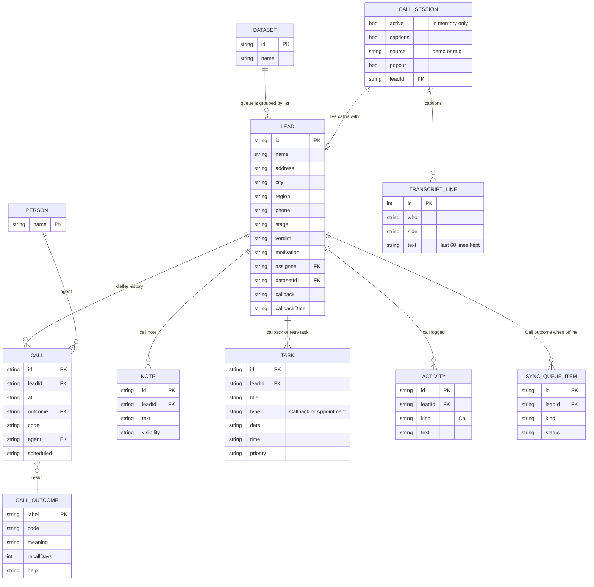

# Page 05 – Calls (`#/work/calls`, `#/work/calls/:leadId`, `?list=:datasetId`)

Source: `src/Work.jsx` (`Calls`), `src/CallAssistant.jsx`, `src/LiveCaptions.jsx`, `src/callSession.js`. Needs the `call` capability. No number is dialled and no audio is recorded.

The queue is built from visible leads whose stage is not Closed and whose verdict is not Do not call / Wrong number. It is grouped by source list, callbacks due first, then never-called leads. While a call is live (focus mode) the queue is hidden.

## ER diagram

`CALL_SESSION` and `TRANSCRIPT_LINE` live outside the saved state (`callSession.js`). Only the `captions` and `source` choices are written to browser storage (`turf.full-crm.captions`, `…captions-source`).

## Outcomes and what they change (`CALL` action)

| Outcome (code) | Meaning | Lead change | Next try |
| --- | --- | --- | --- |
| Transfer (Trans) | reached | stage → Qualified, `sentTo` = Appointments; adds an Appointment task | none |
| Callback (CB) | reached | sets `callback` / `callbackDate` from the time the person picks (required); callback task | the chosen time |
| Not interested (NI) | reached | stage → Contacted if it was New | +90 days |
| Language barrier (Lang) | reached | as above | none |
| Voicemail (VM) | voicemail | – | +1 day |
| Not available (NA) | no_answer | – | +1 day |
| Dead call (Dead) | no_answer | – | +1 day |
| Wrong number (W#) | wrong_number | verdict → Wrong number | none |
| Do not call (DNC) | do_not_call | stage → Closed, verdict → Do not call | none |

Each call appends a `CALL` row to `lead.calls`, adds an `ACTIVITY` (kind Call), replaces the lead's open callback `TASK`, bumps `lead.version`, and optionally adds a `NOTE` from the call note box. It is queued as a `SYNC_QUEUE_ITEM` when offline.

## UI elements → data

| Element | Data |
| --- | --- |
| Call list picker | `DATASET.name` and counts per list (leads with no list show as "Direct leads") |
| Queue rows | `lead.name`, `address`, `callbackLabel(callbackDate, callback)` |
| Person card | `lead.name/address/city/region/phone/verdict/motivation/assignee` |
| Script select (local UI state) | not stored; options like "First conversation" |
| Record demo session (local UI state) | not stored |
| Outcome buttons | `CALL_OUTCOME` (9 rows), `help` text as hint |
| Note box | becomes a `NOTE` |
| About this lead tabs | History: `lead.calls` newest first. Location: `PropertyMap` |
| Call assistant / cues | `src/cues.js` keyword cues over the transcript; not stored |
