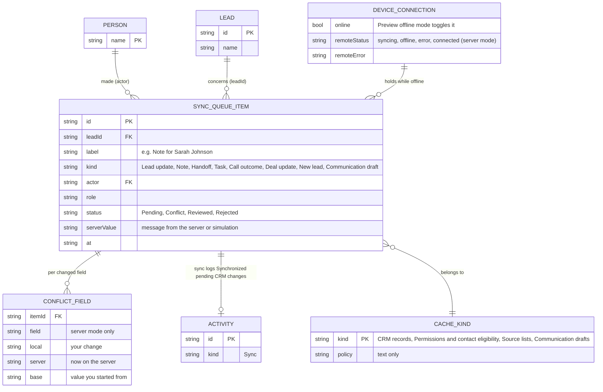

# Page 16 – Sync and pending changes (`#/sync`)

Source: `src/Management.jsx` (`Sync`), `src/remote/session.js`, `src/remote/engine.js`, `src/remote/translate.js`. Reached from the Turf logo menu ("Sync & pending changes"); not in the sidebar. Every role can open it.

In sample mode the queue is a simulation: offline edits become `SYNC_QUEUE_ITEM` rows and "Sync" clears them. In connected mode each row mirrors a real operation sent to the server.

## ER diagram

## UI → data

| Element | Data / action |
| --- | --- |
| Sync pending changes button | enabled when online and at least one pending item that is not a Conflict or a draft. `SYNC` removes the person's items except Conflict and Communication draft; adds an `ACTIVITY` (kind Sync). In server mode it calls the engine instead |
| Connection card | pending item count for this person, shows "Connected · ready to sync" or "Offline · your work is still here". Button toggles `CONNECT {online}` |
| Cached by kind card | static text for the four `CACHE_KIND` rows |
| Pending changes list | one row per `SYNC_QUEUE_ITEM` of the signed-in person: icon, `label`, `kind`, `actor`, status badge. Drafts show a "Not sent" badge |
| Preview a conflict | `CONFLICT` marks the first eligible pending item as Conflict (sample mode only) |
| Review conflict modal | sample mode: your change vs server version. Server mode: one pair per `CONFLICT_FIELD` (your change, now on the server, was) |
| Keep my change / Discard pending operation | `RESOLVE` → status Reviewed, or the item is removed. In server mode "Use the server's" drops the change |

Stored items only exist while offline or unconfirmed. In server mode the offline copy is the encrypted vault described in [18-sign-in-gate.md](18-sign-in-gate.md).
