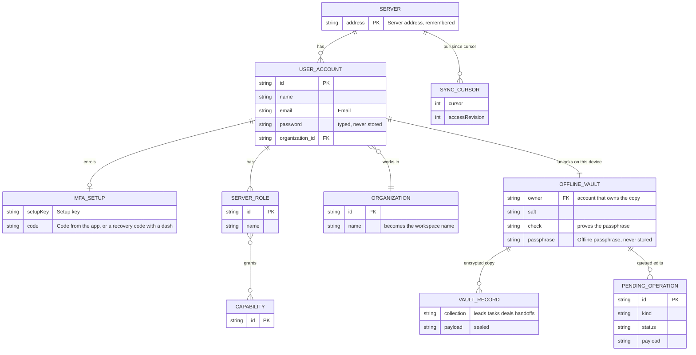

# Page 18 – Server sign-in gate (full-screen, replaces the workspace)

Source: `src/RemoteGate.jsx`, `src/remote/api.js`, `src/remote/vault.js`, `src/remote/engine.js`, `src/remote/translate.js`. Shown when connection mode is `gate`: either a saved server address exists or the person chooses "Connection preview" in the Turf logo menu. "Use the sample workspace" leaves it. Once signed in, the same pages are shown with server data (`connection = remote`).

## ER diagram

## Screens and calls

| Screen | Fields | API call |
| --- | --- | --- |
| Sign in | Email, Password | The auth service: `POST /v1/sessions`, then `GET /api/v1/me` on the core API with its token |
| Sign-in code | Sign-in code, or recovery code | The auth service: `POST /v1/sessions` again with `code` |
| Set up the code | Setup key, Code from the app | The auth service: `POST /v1/mfa/setup`, `/v1/mfa/confirm` |
| Offline passphrase | Offline passphrase | none: unlocks the local encrypted vault. A wrong phrase is rejected. A vault owned by another account is wiped first |
| After sign-in | – | `GET /api/v1/directory`, `/admin/teams`, `/projects`, then `/sync/snapshot`, `/sync/pull`, `/sync/push` and the `/events` WebSocket |

After sign-in the role comes from the server (`applyIdentity`): `me.capabilities` replace the sample presets, and leads, tasks, deals, handoffs and datasets are loaded from the server. Threads and activities stay empty in this mode. Sample-only settings (`SETTINGS`, `RULE`, `PERMISSION`, `INTEGRATION`, `REPORT_SCHEDULE`, `PERSONAL`, `MARK_READ`, `SOURCE_MAPPING`, `CHECK`, `IMPORT`, `NEW_THREAD`) never leave the device (`LOCAL_ONLY`).

Server records are kept only in the encrypted vault, never in plain browser storage.
