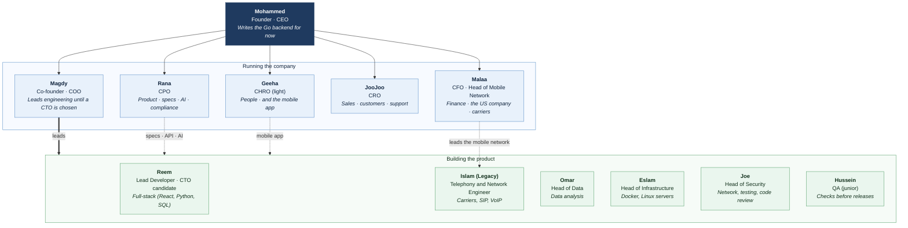
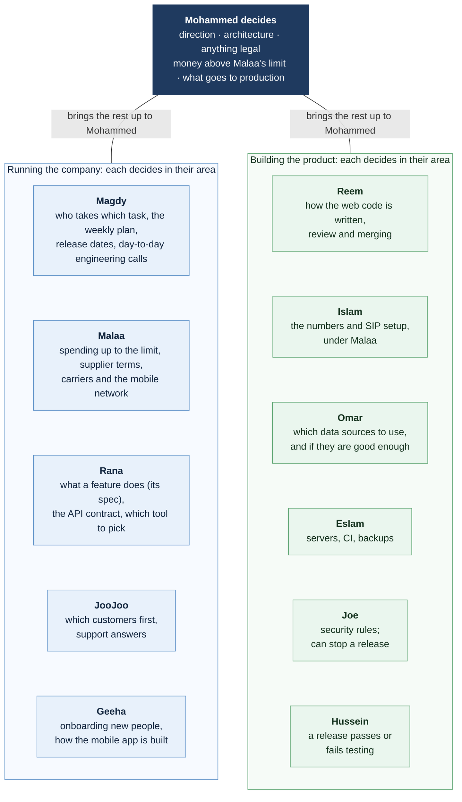
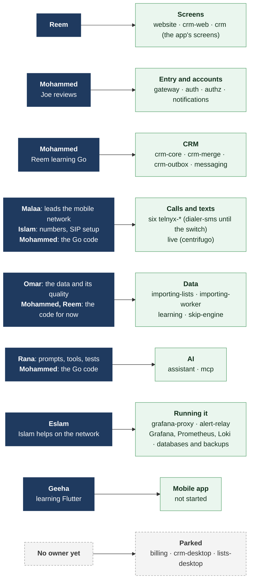
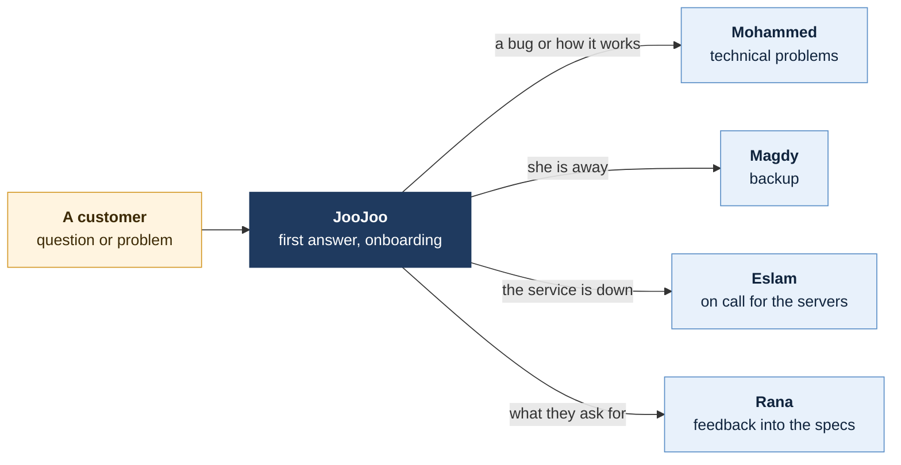
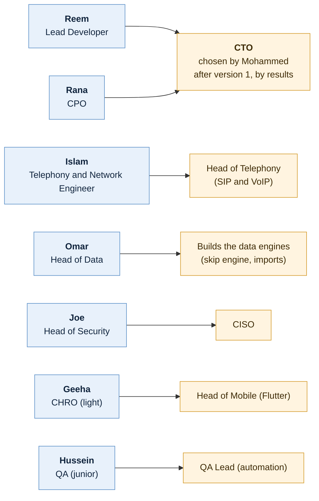

# The team

Who is on Caller Whale, what each person owns, and who decides what. The work waiting to be done is in [tasks/](tasks/README.md),
grouped by area and **not assigned to anyone yet**. How a feature passes from Rana to Magdy to Reem, with their work drawn step by step, is in
[how-the-work-flows.md](how-the-work-flows.md).

Written 2026-11-24, from Mohammed's answers. Titles marked *later* are what a person grows into.

## Where we are

- **The goal:** finish version 1 and get the customers who are already waiting onto it. Everything else comes after.
- **So far only Mohammed and Magdy have built Caller Whale.** The team was gathered so the work is shared and the two of them
  can step back from doing everything.
- **Pay:** nobody is paid yet. Pay starts once Caller Whale has earned EGP 50,000, so it runs itself instead of on debt.
- **A trial first:** everyone starts with 2 to 4 weeks of small tasks. Ownership and titles below are confirmed after it.
- **Titles are shared out.** Mohammed keeps one C-title (CEO), so the titles and the weight that comes with them are spread
  fairly across the team.
- **The CTO is chosen after version 1**, by results. Reem and Rana both get real technical ownership; Mohammed picks. Until then
  Magdy, as co-founder and COO, leads the engineering work day to day and brings the final calls to Mohammed.

## The diagrams

### Who reports to whom

The five company leads report to Mohammed. The engineers report to Magdy day to day until a CTO is chosen; their technical
questions go through him to Mohammed (the thick line). The outside help (lawyer, security tester, designer) is in the
table below. Rana, Geeha and Malaa sit on the company side but also build: Rana the specs, the API contract
and the AI assistant, Geeha the mobile app, and Malaa leads the mobile network, with Islam doing the hands-on setup.

### Who decides what

Each lead decides inside their own area and tells Magdy. A decision goes up to Mohammed only when it touches the direction,
the architecture, the law, money above Malaa's limit, or what goes to production.

### Who owns which containers

Every container, grouped by what it does. Where someone is still learning the code, the person writing it for now is named
too. Joe reviews the security of all of it, and Hussein tests it before a release.

### Who answers the customers

The first customers are in the US, so someone covers US daytime (evening and night in Egypt).

### Where each person is heading

Rana and Reem both have a road to CTO: Reem through the code she ships, Rana through the specs, the API contract and the AI
work. Whoever is not chosen keeps their title (Rana stays CPO; Reem leads the web code).

## The people

### Running the company

| Person | Title now | Title later | Strength | Owns |
| --- | --- | --- | --- | --- |
| **Mohammed** | Founder · CEO | — | Built everything so far | Direction, final decisions, architecture and the D-numbers, approving `production`, secrets in Coolify, the Go backend until others take it, technical help for customers |
| **Magdy** | Co-founder · COO | — | With Mohammed from the start; understands the system, follows pull requests, builds with AI and reviews | The task board, weekly plan and status, leading engineering day to day until a CTO is chosen, release checks, `docs/plans/` and the decision list, admin and contracts, backup on customer support |
| **Malaa** | CFO · Head of Mobile Network | — | Thinks well about money; contacts in the US (he lives in Egypt); knows mobile networks best on the team | Budget and runway, registering and running the US company through his contacts, bank, taxes and accountant, Paddle and Stripe accounts, supplier deals, investors; **mobile network:** carriers, numbers, SIP trunks and 10DLC, leading Islam |
| **Rana** | CPO | CTO candidate | Finds answers fast and precisely, often before being asked; studied mobile networks, Python and some machine learning | Research before each decision, compliance and the lawyer's questions, `docs/legal/research/`; **technical:** feature specs with their acceptance checks, the API contract (`contracts/`), the AI assistant's prompts, tools and tests, product numbers in SQL with Omar, anti-cloning with Joe |
| **JooJoo** | CRO | — | Has dealt with US, foreign and Egyptian customers; good English | The waiting customers first, demos and sales, onboarding, first-line support on US hours, customer feedback to Rana |
| **Geeha** | CHRO (light) | Head of Mobile | Good with people; started with Dart | Mainly: learning Flutter and building the mobile app. On the side: onboarding new people and the team's mood |

### Building the product

| Person | Title now | Title later | Strength | Owns |
| --- | --- | --- | --- | --- |
| **Reem** | Lead Developer | CTO candidate | Full-stack, junior (React, JavaScript, Python, SQL and NoSQL) | `apps/crm`, `apps/crm-web`, `apps/website`; review of web code; learns Go on small `crm-core` tasks; helps on the Python importers |
| **Islam (Legacy)** | Telephony and Network Engineer | Head of Telephony | CCNA, CCNP, mobile networks, works in DevOps; does not code yet | Under Malaa: Telnyx setup, numbers, SIP trunks and 10DLC by hand; studies core PS, SIP and VoIP; helps Eslam with networking. The Go code of `telnyx-*` stays with Mohammed |
| **Omar** | Head of Data | — | Analyses large real-world data of the kind our customers use | Which data sources the skip engine and imports should use and how good they are; numbers and reports; grows into building `engines/skip-engine` and the importers |
| **Eslam** | Head of Infrastructure | — | Has run Docker and Linux servers | Coolify and the VPS, CI and images, production branches, monitoring and `alert-relay`, backups, databases; on call when a server breaks |
| **Joe** | Head of Security | CISO | Network security, hands-on testing and code review (CompTIA Network+ and Security+) | Security review of pull requests that touch `gateway`, `auth`, `authz`, `grafana-proxy`; Cloudflare and firewall; secret changes; [security upkeep](../operations/security-upkeep.md); anti-cloning with Rana |
| **Hussein** | QA (junior) | QA Lead (automation) | Studying software testing; a few hours a week | [Checks by hand](../plans/people-teams-chats-clients/checks-by-hand.md) before each release, and the sign-off |

### From outside, when needed

| Who | For |
| --- | --- |
| A US lawyer | Terms, privacy, consent wording, calling and texting law ([what they are asked](../plans/people-teams-chats-clients/08-for-the-lawyer.md)) |
| An outside security tester | One test before opening to customers |
| A designer | The web rebuild, if the team's own design is not enough |

## Who decides what

| Work | Owner |
| --- | --- |
| Direction, money above Malaa's limit, anything legal, architecture, what goes to production | **Mohammed** |
| Running the week: meetings, goals, who does what, status to Mohammed | **Magdy** |
| Engineering day to day until a CTO is chosen: assigning tasks, unblocking, release checks | **Magdy**, with Hussein's sign-off |
| Budget, runway, spending up to a limit Mohammed sets, the technology bill | **Malaa** |
| The US company, bank, taxes, payment accounts, investors | **Malaa** |
| What to build next and why; research for each decision, brought as options with a recommendation | **Rana** |
| Feature specs and acceptance checks; the API contract; the AI assistant's behaviour | **Rana**, with Reem (code) and Hussein (tests) |
| Pricing: what each tier holds (Rana) and the margins (Malaa) | **Rana** + **Malaa** |
| Compliance: do not call, TCPA, 10DLC, privacy, working with the lawyer | **Rana** |
| Protecting the app from being copied: the licence terms (with the lawyer) and the technical measures | **Rana** + **Joe** |
| Sales, onboarding, support, customer feedback | **JooJoo** |
| Onboarding new people, the team's mood | **Geeha** |
| Code review and technical guidance | **Reem** (web, Python), **Joe** (security), **Eslam** (infrastructure), **Mohammed** (Go) |
| Carriers, numbers, SIP trunks, 10DLC: the mobile network | **Malaa**, with Islam doing the setup |
| The CTO choice, after version 1 | **Mohammed** |

## Not covered yet

- **Go backend:** only Mohammed writes Go today, and about half the containers are Go. Reem learns it on small `crm-core` tasks.
- **The Python importers and the skip engine:** written by Mohammed; Reem helps now, Omar takes them over as he starts building.
- **Telnyx code:** Malaa leads the mobile network and Islam does the setup, but neither codes yet, so the `telnyx-*` code stays with Mohammed.
- **Desktop app (Rust, Tauri):** parked until the web version is done. No owner.
- **Billing:** parked. When it starts, Reem builds it (Python), Malaa owns the accounts and Joe reviews it.
