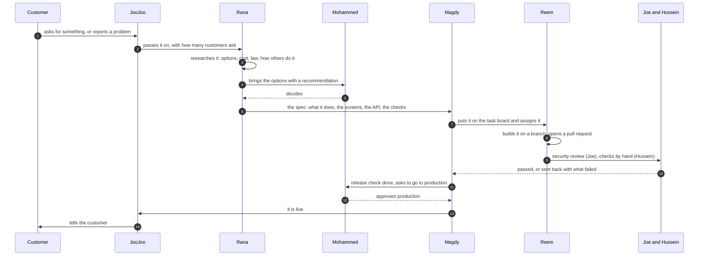
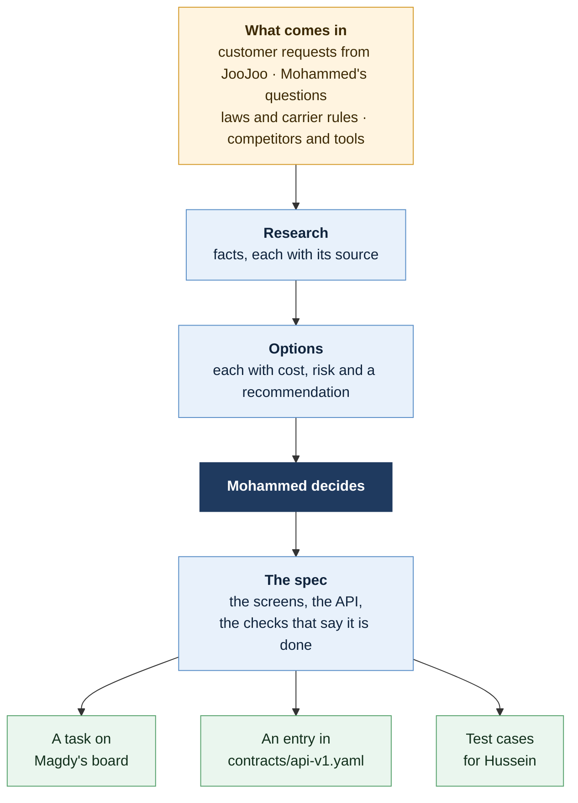
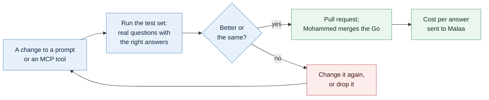
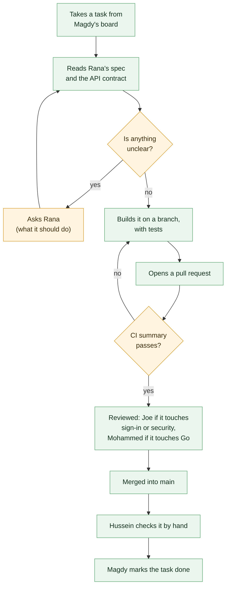
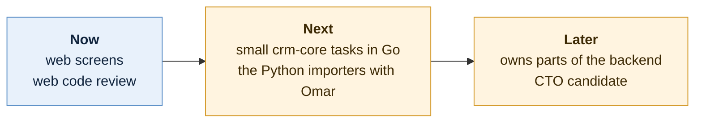
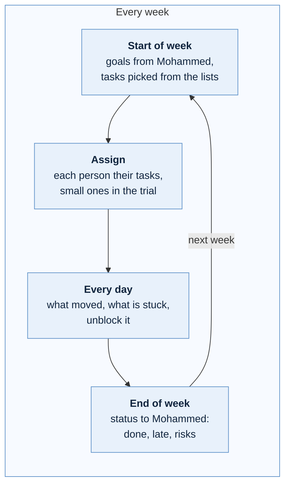
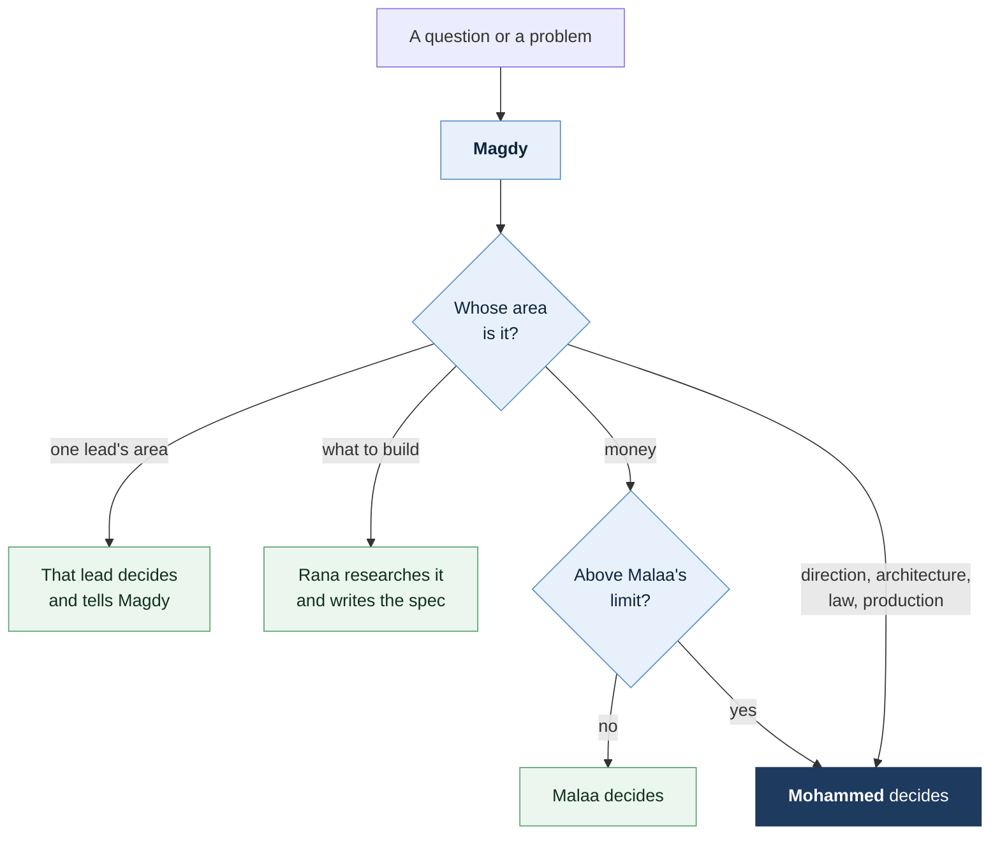
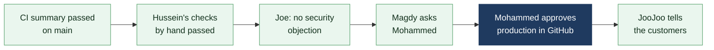

# How the work flows

What Rana, Reem and Magdy each do, and how a feature passes between them. Who owns what is on the [team page](README.md);
the work waiting to be taken is in [tasks/](tasks/README.md).

In one line: **Rana says what to build, Magdy gets it built, Reem builds it**, and Mohammed makes the final calls.

## A feature from idea to customer

Steps 3 to 5 are Rana's, 6 and 7 and 10 to 12 are Magdy's, 8 is Reem's. When anything is unclear, the question goes back
one step, not straight to Mohammed.

## Rana: what to build, and why

Rana turns questions into decisions and decisions into specs. She does not write the product's code, but she writes everything
the code is built from, and she owns how the AI assistant behaves.

### Rana and the AI assistant

Every change to the assistant's prompts or tools is tested before it ships, so it never gets worse without anyone noticing.

| Rana does | Rana does not |
| --- | --- |
| Research, options and a recommendation for each decision | Make the final call (Mohammed does) |
| Specs with acceptance checks; the API contract | Write the product's screens or services |
| The assistant's prompts, tools and test set | Merge Go code |
| Compliance research and the lawyer's questions | Give legal advice; the lawyer words it |
| Product numbers in SQL, with Omar | Run the servers |

## Reem: building it

Reem builds the screens (`apps/crm`, `apps/crm-web`, `apps/website`), reviews other people's web code, and learns Go on small
`crm-core` tasks. Every change she makes follows the same road to `main` (see [AGENTS.md](../../AGENTS.md)).

### Reem's road to more

| Reem does | Reem does not |
| --- | --- |
| Builds the screens and the website | Decide what a feature does (Rana's spec does) |
| Reviews web and Python pull requests | Approve production (Mohammed does) |
| Learns Go on small `crm-core` tasks | Change Go services alone yet; Mohammed reviews |
| Says how long a task will take | Pick her own tasks; Magdy assigns them |

## Magdy: getting it built

Magdy runs the week. He turns Mohammed's goals into tasks, gives them out, keeps them moving, and is the first stop for any
question. Until a CTO is chosen he also leads the engineers day to day.

### Where a question goes

Most questions stop with Magdy or a lead. Only the five things on the team page go to Mohammed.

### Before anything goes to production

| Magdy does | Magdy does not |
| --- | --- |
| The task board, the weekly plan and the status | Decide direction or architecture |
| Assigns tasks and follows them up | Approve production (he asks Mohammed) |
| Leads the engineers day to day until a CTO is chosen | Override a lead inside their own area |
| Release checks before asking for production | Skip Hussein's or Joe's checks |
| Keeps `docs/plans/` and the decision list current | Write the specs (Rana does) |
| Backup on customer support | |
