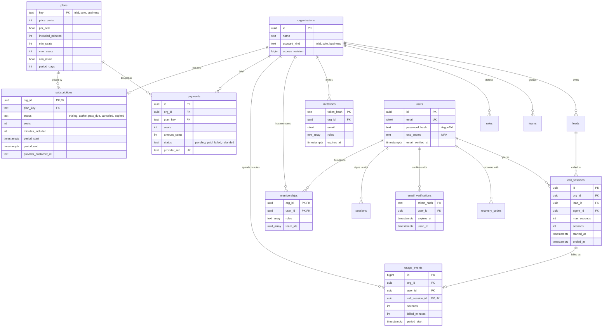

# Turf as a paid service (SaaS)

Turf is a CRM and a dialer for property outreach, sold as a service: people sign up on the website, try it on a short
trial, then pay for **Solo** (one person) or **Business** (a team with seats and roles). Nobody uses the app without
signing in, and the server enforces every limit.

Everything here runs on the existing Rust API and PostgreSQL (`backend/`), which suits a single Hostinger VPS.

## Plans

| Plan | Price | Minutes | Seats | Team invitations | Period |
| --- | --- | --- | --- | --- | --- |
| Free trial | Free | 10 | 1 | No | 7 days |
| Solo operator | $149 / month | 5,000 | 1 | No | 30 days |
| Business | $129 per seat / month | 4,000 per seat, pooled | 2–500 | Yes, up to the seats paid for | 30 days |

Prices and minutes live in the `plans` table, so they change without a deploy. Business minutes are pooled: 3 seats
means 12,000 minutes shared by the team.

## How a customer moves through it

1. **Sign up** on the website (`/#/signup`): name, email, password (12+ characters), optional business name. This
   creates the user, a new organization, the role presets, the owner membership and a **trial** subscription.
2. **Protect the account.** Owners and administrators set up an authenticator code and get ten recovery codes.
3. **Confirm the email address.** This is required before buying a plan.
4. **Use the trial.** The CRM and Skip Tracing work; calls draw from the 10 minutes.
5. **Trial ends** (7 days, or the minutes are used up). CRM data requests answer `402 payment_required`. The website's
   account page and checkout still work, so the owner can pay.
6. **Checkout** records a pending payment and sends the browser to the payment provider. Only the provider's **signed
   webhook** marks it paid. That switches the plan, starts a new period with full minutes, and sets the seats.
7. **Business owners invite their team.** Each invitation has a role: manager, caller, closer, researcher,
   administrator or client. The role decides what that person can see and do. An open invitation holds a seat. When
   every seat is taken, inviting is refused until seats are added.

## Database (new tables in `backend/rust/migrations/0007_saas.sql`)



`plans` is shared reference data. Every other new table carries `org_id` under PostgreSQL row-level security, so one
organization can never read another's subscription, payments or usage. This is the same rule as every CRM table. The
existing CRM tables (`leads`, `contacts`, `properties`, `deals`, `tasks`, `notes`, `call_events`, `conversations`, …)
are unchanged.

### What is stored and what is not

| Stored | Not stored |
| --- | --- |
| Password hashes (Argon2id), never passwords | Card numbers or bank details: the payment provider keeps them |
| Hashes of session, invitation and verification tokens | The tokens themselves |
| One `usage_events` row per finished call (append-only) | Call lengths reported by the browser: the server times calls |
| Payments: plan, seats, amount, status, provider reference | Provider secrets in plain text (`integrations` holds ciphertext) |
| Subscriptions: plan, seats, minutes, period | Anything outside the organization's own rows |

## API (all under `/api/v1`)

| Method | Path | Who | What |
| --- | --- | --- | --- |
| GET | `/plans` | anyone | The plan catalogue |
| POST | `/auth/signup` | anyone (rate limited) | Account, organization and trial; signs in |
| POST | `/auth/verify-email` | anyone with the token | Confirms the address (single use, 2 days) |
| POST | `/auth/verify-email/resend` | signed in | New link, at most one a minute |
| GET | `/billing` | members | Plan, status, seats, minutes; payments for owners and administrators only |
| POST | `/billing/checkout` | owner or administrator, email confirmed | Pending payment, then the provider's checkout address |
| POST | `/billing/webhook` | payment provider (HMAC signed) | Marks the payment paid or failed; switches the plan |
| POST | `/calls/start` | members with the `call` capability | Opens a call; refused when no minutes are left; answers `max_seconds` |
| POST | `/calls/{id}/end` | the caller (or an administrator) | Closes the call and records its minutes from the server clock |
| POST | `/admin/members` | administrators | Invite; refused on Solo or when seats are full |
| GET | `/auth/providers` | anyone | Whether Google and Apple sign-in are set up |
| GET | `/auth/oauth/{google,apple}/start` | anyone | Sends the browser to the provider (`?target=app` returns to the app) |
| GET/POST | `/auth/oauth/{google,apple}/callback` | the provider | Finishes the sign-in, sets the session, returns to the website or app |
| GET | `/platform/organizations` | platform administrators with MFA | Every customer organization at a glance |

`/me` now also says whether the organization's plan is usable, so the CRM can tell people why it is locked.

## Security

- **Sign-in required everywhere.** The desktop CRM opens on the sign-in screen and cannot fall back to sample data.
  Every API route except `/plans`, sign-up, verification and the webhook needs a session.
- **MFA** for owners and administrators (TOTP plus recovery codes). Five failed sign-ins in 15 minutes pauses that
  address.
- **Organization isolation in the database** (row-level security), not only in code. The API connects as a role that
  cannot bypass it.
- **Payments only change through the signed webhook.** It checks the HMAC-SHA256 signature in constant time, the
  amount must match the checkout, each provider event acts once, and a payment is settled once.
- **Minutes cannot be overdrawn.** Starting a call locks the subscription row. Minutes promised to calls still open
  count as spent. A call's length comes from the server clock and is capped at what it was allowed.
- **Seats cannot be overdrawn.** Invitations and joins lock the subscription row and count members plus open
  invitations.
- **CSRF**: cookie-authenticated writes need the `X-Turf-Request` header. Session cookies are HttpOnly, SameSite=Lax
  and Secure in production.
- **Website headers**: a strict Content-Security-Policy (no inline scripts, no framing), `nosniff`, same-origin
  referrer. The page writes user data only as text.
- **Sign-up abuse**: at most 30 new accounts per 10 minutes per server, one account per email. Put per-address limits in
  nginx as well.

## Google sign-in

The sign-up and sign-in pages on the website, and the app's sign-in screen, offer **Continue with Google** above the
email form. Apple is not offered: it needs a paid Apple Developer account and an HTTPS domain. The server supports it,
but it stays off until `TURF_APPLE_*` are set and a button is added back. A new person gets the same trial as the email sign-up. Someone whose
verified Google address matches an existing account signs in to that account.

The server does the whole exchange itself (OpenID Connect authorization code flow):

- a single-use state (kept only as a hash, 10 minutes), a nonce, and PKCE for Google;
- the ID token's signature is checked against the provider's published keys (RS256 only), along with its issuer,
  audience and expiry, and the nonce must match;
- the provider must say the email address is verified.

Tests run the whole flow against a fake provider. They show that edited, expired, replayed, wrong-audience,
wrong-issuer and unverified sign-ins are all refused.

The button says "not connected on this server yet" until the keys are set. On this development machine they are in
`backend/.env.local` (git-ignored, loaded by `run-api.sh`): Google Cloud project **Turf** (`turf-512607`) on
softfix.dev@gmail.com, OAuth client **Turf Web**. The app is in Google's *Testing* mode, so only its listed test users
can sign in (mo7amed.magdy28, mmeegoo20 and softfix.dev). Publish it on the Audience page before real customers use it.

| Provider | Environment variables | Where to get them |
| --- | --- | --- |
| Google | `TURF_GOOGLE_CLIENT_ID`, `TURF_GOOGLE_CLIENT_SECRET` | Google Cloud Console → APIs & Services → Credentials → OAuth client ID (Web application). Authorized redirect URI: `{TURF_PUBLIC_URL}/api/v1/auth/oauth/google/callback` |
| Apple | `TURF_APPLE_CLIENT_ID` (the Services ID), `TURF_APPLE_TEAM_ID`, `TURF_APPLE_KEY_ID`, `TURF_APPLE_PRIVATE_KEY` (the .p8 file) | Apple Developer → Certificates, IDs & Profiles: a Services ID with Sign in with Apple, and a key with Sign in with Apple. Return URL: `{TURF_PUBLIC_URL}/api/v1/auth/oauth/apple/callback` |

`TURF_PUBLIC_URL` is the server's address as browsers see it. `TURF_APP_URL` is where a sign-in started in the app
returns to. Apple only accepts HTTPS return addresses on a real domain, so Apple sign-in works once the server is
deployed, not on localhost. Google works on `http://localhost:8088`.

For the packaged desktop app, Google may refuse sign-in inside an embedded window. If it does, the next step is to
open the system browser and return through a turf:// link.

### Desktop app

Google does not allow sign-in inside an embedded app window, and the window must never leave the app. So the desktop
app opens Google in the person's own browser, starting at `/auth/oauth/google/start?target=desktop&port=<p>`. When
Google is done, the server sends the browser to `http://127.0.0.1:<p>/turf-sign-in` with a one-time code. Only the
app on that same computer is listening there, and it trades the code at `POST /auth/oauth/exchange` for its own
session. The code works once, for two minutes, and is stored only as a hash. The browser shows "You're signed in,
return to Turf"; the app shows Cancel while it waits.

## The authenticator step (MFA)

Off for now: `TURF_REQUIRE_MFA` is unset, so owners and administrators go straight in after their password or Google.
Set `TURF_REQUIRE_MFA=true` to bring back "Protect your account" for owners, administrators and the Customers page.
The rest is already built: setup, codes, recovery codes, and the tests (which run with it on).

## Platform administrators

The people who run Turf the service. They get a workspace with no plan limits and a **Customers** page on the website:
every organization with its owner, plan, real status (a lapsed period shows as expired), minutes, seats, members and
amount paid. CRM records are never shown there. The page always needs the authenticator code. The database function
behind it refuses anyone who is not a platform administrator. Nobody can become one through the API:

```bash
python backend/scripts/create_platform_admin.py <email> "<name>" ["<workspace>"]   # asks for the password
```

## Running it locally

```bash
python backend/scripts/dev_db.py                    # once: roles and databases (Windows portable PostgreSQL, no psql needed)
bash backend/scripts/run-api.sh                     # API + website on http://127.0.0.1:8088
python backend/scripts/dev_pay.py <payment> <cents> # plays the payment provider after a checkout
```

Open http://127.0.0.1:8088 to sign up. The CRM (`testing Full CRM mode`, `npm run dev`) signs in to the same server
through the Turf menu's **Connect to a Turf server**. The desktop app always asks for it.

## Deploying on a Hostinger VPS

1. Ubuntu VPS with PostgreSQL 16+ and nginx. Create the roles as in `backend/scripts/dev-services.sh`, with strong
   passwords.
2. Build `cargo build --release -p turf-api` and run it under systemd with `DATABASE_URL`, `MIGRATION_DATABASE_URL`,
   `TURF_SITE_DIR=/srv/turf/website`, `TURF_BILLING_WEBHOOK_SECRET` (32+ random characters), `TURF_CHECKOUT_URL`,
   `TURF_ALLOWED_ORIGINS`, and `TURF_SECURE_COOKIES=true` (the default). Leave `TURF_DEV_TOKENS` unset.
3. nginx terminates HTTPS (Let's Encrypt), proxies to `127.0.0.1:8088`, and rate-limits `/api/v1/auth/`.
4. Connect a payment provider (Stripe, or Paymob for Egypt). Its webhook adapter must sign the body with the shared
   secret, or a small adapter translates the provider's own signed event into Turf's `payment.succeeded` /
   `payment.failed`.
5. Connect an email provider for verification links and invitations. Until then, links are logged as issued, without
   the token.
6. Back up PostgreSQL nightly (`pg_dump`) off the VPS.

## Competitors (October 2026, third-party listings)

| Product | Price | Model | Trial |
| --- | --- | --- | --- |
| ReadyMode | $199 (Starter) / $249 (iQ) per user / month; iQ required for 5+ licences | Per seat, outbound minutes under fair use, inbound about $0.02/min | No free trial listed |
| BatchDialer | Enterprise $249 per agent / month ($199 annual); Starter and Pro below | Per agent, 3–5 lines | 7 days, AI features and 3 numbers |
| Mojo Dialer | $139 triple line + $10 agent access per user / month | Per licence, unlimited minutes | — |
| PhoneBurner | $140–$183 per user / month (annual) | Per seat | — |
| Kixie | Quote only; reported $95–$215 per user / month | Per seat, add-ons $20–50 each | — |

Turf's edge: Skip Tracing is built in (others sell lead data and skip tracing separately), and the CRM is property-first
(owners, properties, handoffs, deals). Plans are priced under ReadyMode and BatchDialer per seat. Turf meters minutes
where they offer "unlimited under fair use": that keeps carrier costs predictable on a small VPS business, and a solo
plan with no seat minimum undercuts them for one-person operators.

Sources: [Capterra · Readymode pricing](https://www.capterra.com/p/136728/Readymode/pricing/),
[BatchDialer new plans](https://batchdialer.com/blog/batchdialer-introduces-new-plans-simplified-pricing-built-in-ai-and-more-value-included),
[Ringover · Mojo pricing](https://www.ringover.com/blog/mojo-dialer-pricing),
[JustCall · PhoneBurner alternatives](https://justcall.io/hub/alternatives/phoneburner-competitors/),
[Aloware · Kixie pricing](https://aloware.com/blog/kixie-pricing).

## Not done yet

- Real payment and email providers (the webhook and the email hooks are ready for them).
- The dialer's voice itself (carrier/SIP). `/calls/start` and `/calls/end` are the metering points it must call.
- Closing calls that are never ended (a worker sweep), and automatic monthly renewal reminders.
- Sign-up says when an email is already registered; hide this if account enumeration matters more than clarity.
