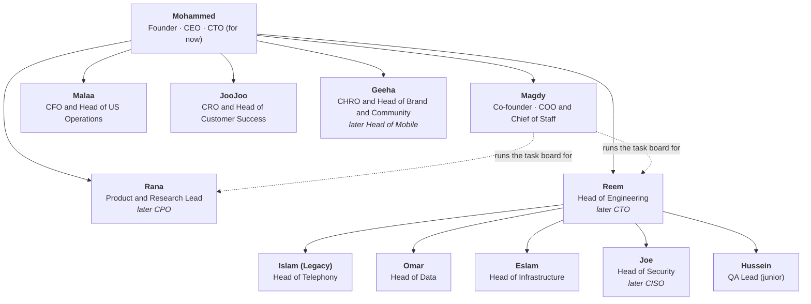

# The team

Who is on Caller Whale, what each person owns, and who decides what. The work waiting to be done is in [tasks/](tasks/README.md),
grouped by area and **not assigned to anyone yet**.

Written 2026-11-23. Titles marked *later* are what a person grows into; until then everyone goes by the title now.

## The diagram

Solid lines are who reports to whom. The dotted lines show that Magdy runs the day-to-day work of both sides: he turns
decisions into tasks, hands them out and follows them up. Technical calls go up through Reem to Mohammed.

## The people

### Running the company

| Person | Title now | Title later | Strength | Owns |
| --- | --- | --- | --- | --- |
| **Mohammed** | Founder · CEO · CTO | CEO (CTO passes to Reem) | Built everything so far | Direction, final decisions, architecture and the D-numbers, approving `production`, secrets in Coolify, the Go backend until Reem takes it |
| **Magdy** | Co-founder · COO and Chief of Staff | — | Carries out Mohammed's direction faithfully | The task board, weekly plan and status, chasing blockers, release checks, keeping `docs/plans/` and the decision list current, admin and contracts |
| **Malaa** | CFO and Head of US Operations | — | Finance; contacts in the US | Budget and runway, the US company, bank, taxes and accountant, Paddle and Stripe accounts, supplier deals, investors and partnerships |
| **Rana** | Product and Research Lead (and Compliance Lead) | CPO | Researches anything fast and precisely; fresh graduate | Research before each decision, tool and supplier comparisons, competitors and pricing proposals, `docs/legal/research/`, the lawyer's questions |
| **JooJoo** | CRO and Head of Customer Success | — | Has dealt with customers the most | First agencies and beta testers, demos and sales, onboarding and support, customer feedback to Rana |
| **Geeha** | CHRO and Head of Brand and Community | Head of Mobile | Talks well, convinces, good with people; started with Dart | Hiring and onboarding, culture, marketing and social, events and demos with JooJoo; learns Flutter for the mobile app |

### Building the product

| Person | Title now | Title later | Role | Owns |
| --- | --- | --- | --- | --- |
| **Reem** | Head of Engineering | CTO | Full-stack developer (React, JavaScript, Python, SQL and NoSQL) | `apps/crm` (the CRM web app), `apps/website`; day-to-day code review; backup on `importing-*`; learns Go on `crm-core` |
| **Islam (Legacy)** | Head of Telephony | — | Telecom engineer (mobile core PS/CS) | `dialer-sms`, the six `telnyx-*` containers, `centrifugo`; carriers, numbers, 10DLC |
| **Omar** | Head of Data | — | Data engineer and analyst (Python) | `engines/skip-engine`, `importing-lists`, `importing-worker`, `learning`; numbers and reports for the business side |
| **Eslam** | Head of Infrastructure | — | DevOps engineer | Coolify and the VPS, CI and images, production branches, monitoring and `alert-relay`, backups, databases |
| **Joe** | Head of Security | CISO | Security engineer (CompTIA Network+ and Security+) | Security review of `gateway`, `auth`, `authz`, `grafana-proxy`; Cloudflare and firewall; secret changes; [security upkeep](../operations/security-upkeep.md) |
| **Hussein** | QA Lead (junior) | — | Studying software testing, manual first | [Checks by hand](../plans/people-teams-chats-clients/checks-by-hand.md), test cases per step, the sign-off before a release |

### From outside, when needed

| Who | For |
| --- | --- |
| A US lawyer | Terms, privacy, consent wording, calling and texting law ([what they are asked](../plans/people-teams-chats-clients/08-for-the-lawyer.md)) |
| An outside security tester | One test before opening to customers |
| A designer | The web rebuild, if the team's own design is not enough |

## Who decides what

The CEO's and CTO's work is shared out so that Mohammed decides and the others carry it out.

| Work | Owner |
| --- | --- |
| Direction, money above Malaa's limit, anything legal, architecture | **Mohammed** |
| Running the week: meetings, goals, who does what, status to Mohammed | **Magdy** |
| Engineering process: the task board, assigning tasks, release checks before `production` | **Magdy**, with Hussein's sign-off |
| Budget, runway, spending up to a limit Mohammed sets, the technology bill | **Malaa** |
| The US company, bank, taxes, payment accounts, investors | **Malaa** |
| What to build next and why; research for each decision, brought as options with a recommendation | **Rana** |
| Pricing: what each tier holds (Rana) and the margins (Malaa) | **Rana** + **Malaa** |
| Compliance: do not call, TCPA, 10DLC, privacy, working with the lawyer | **Rana** |
| Sales, onboarding, support, customer feedback | **JooJoo** |
| Hiring, onboarding, culture, marketing, the brand | **Geeha** |
| Code review and technical guidance | **Reem** (frontend, Python), **Joe** (security), **Eslam** (infrastructure) |
| Technology and supplier comparisons before building | **Rana** |
| Finding engineers; the technical interview | **Geeha**; **Reem** or **Mohammed** |

## Not covered yet

- **Go backend:** only Mohammed writes Go today, and about half the containers are Go. Reem learns it on small `crm-core` tasks.
- **Desktop app (Rust, Tauri):** parked until the web version is done. No owner.
- **Mobile app:** Geeha, once he has learned Flutter; until then not started.
- **Billing:** parked. When it starts, Reem builds it (Python), Malaa owns the accounts and Joe reviews it.
